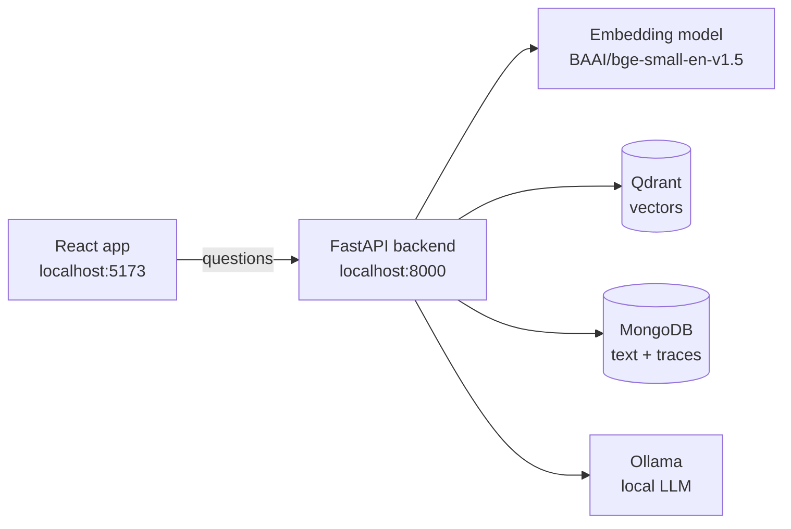

# HYU Compass

**A small, understandable RAG assistant for new Hanyang University students.**

You ask a question like *"How many credits can a first-year student register for?"*. HYU Compass
finds the right passages in the university documents we collected and asks a local AI model to
answer **using only those passages**. It then shows you the sources.

## What is RAG?

**RAG = Retrieval-Augmented Generation.** A language model on its own answers from memory and
may invent things. A RAG system first **retrieves** relevant text from our own documents, then lets
the model **generate** an answer from that text. That is why every answer comes with sources
like `[E1]` that you can check.

## What the app does

- **Ingests** English documents (PDF, TXT, Markdown, HTML) from `data/raw/`.
- **Answers** questions with citations, and says so honestly when the documents don't contain the answer.
- **Shows the whole pipeline.** Choose a method and its settings for each block in the
  *Configuration* tab. The *Execution* tab shows every block's real input, output, parameters and
  time. Future blocks (query rewriting, BM25, reranking…) appear greyed out, so you can see the
  roadmap.
- **Easy to extend.** Every block is an abstract Python class, and every algorithm is a subclass.
  One registry file (`backend/app/rag/registry.py`) lists all methods and hyperparameters, and the
  UI is built from it. To add a method you write a class, register it, and test it.

## Architecture



| Part | Technology |
|---|---|
| Backend | Python + FastAPI (Conda environment `RAG`) |
| Frontend | React + TypeScript + Vite + Tailwind CSS |
| Embeddings | `BAAI/bge-small-en-v1.5` (384 numbers per text) |
| Databases | MongoDB (documents, chunks, traces) and Qdrant (vectors), via Docker Compose |
| LLM | Ollama, running locally |

## Quick start

From the `hyu-compass/` folder. The full tutorial with explanations is in
[docs/01_GETTING_STARTED.md](docs/01_GETTING_STARTED.md).

```bash
cp .env.example .env && cp backend/.env.example backend/.env   # then set a password in both
docker compose up -d                                          # MongoDB + Qdrant
ollama pull qwen3:4b                                          # once, if you have no model

conda activate RAG
python -m pip install -r backend/requirements.txt             # once
python scripts/ingest.py --path data/samples                  # index the sample documents
cd backend && python -m uvicorn app.main:app --reload         # backend (keep running)

cd frontend && npm ci && npm run dev                          # in a second terminal → http://127.0.0.1:5173
```

> The five files in `data/samples/` are **invented** practice documents, not real HYU policy.
> Put real, approved documents in `data/raw/`.

## Documentation

Read them in order:

1. [Getting started](docs/01_GETTING_STARTED.md): install and run everything, step by step.
2. [RAG architecture](docs/02_RAG_ARCHITECTURE.md): every block, why it exists, and where its code is.
3. [Abstract classes](docs/03_ABSTRACT_CLASSES.md): how each block is defined and implemented.
4. [Method registry](docs/04_METHOD_REGISTRY.md): how methods and settings reach the UI.
5. [Add a new method](docs/05_ADD_NEW_METHOD.md): a hands-on tutorial (start here to contribute).
