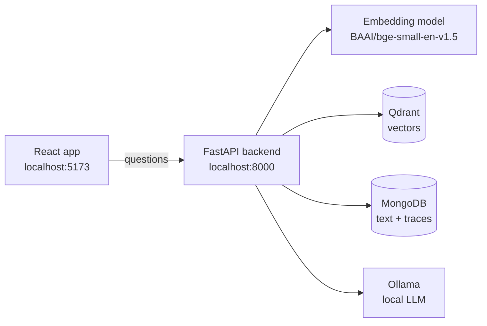

# HYU Compass

**A small, understandable RAG assistant for new Hanyang University students.**

You ask a question like *"How many credits can a first-year student register for?"*. HYU Compass
finds the right passages in the university documents we collected and asks a local AI model to
answer **using only those passages**. It then shows you the sources.

## What is RAG?

**RAG = Retrieval-Augmented Generation.** A language model on its own answers from memory and
may invent things. A RAG system first **retrieves** relevant text from our own documents, then lets
the model **generate** an answer from that text. That is why every answer comes with sources
like `[E1]` that point to the document text they came from.

## What the app does

- **Ingests** English documents (PDF, TXT, Markdown, HTML) from `data/raw/`.
- **Answers** questions with source references, and abstains honestly when the documents don't contain the answer.
- **Shows the whole pipeline.** Choose a method and its settings for each block in the
  *Configuration* tab — or a whole **experiment preset** (B0 basic RAG, O0–O8 offline, R0–R14 online:
  BM25, hybrid RRF, cross-encoder, query rewriting, HyDE, metadata pre/postfiltering, a sufficiency
  gate, RankGPT…). The *Execution* tab shows every block's real input, output, parameters and time.
- **Measures itself.** `python -m evaluation.runner --suite all` runs every baseline on the BEIR
  benchmarks SciFact, NFCorpus and ArguAna (no UI, no FastAPI, the same code as the app), compares
  Llama 2 and Qwen 3.5 on identical evidence, and writes reports with per-query results and failure
  analysis.
- **Easy to extend.** Every pipeline block is a folder inside a group folder of
  `backend/app/rag/blocks/` (`ingestion/`, `query_processing/`, `metadata_filtering/`, `retrieval/`,
  `evidence/`, `grounded_generation/`), e.g. `blocks/retrieval/dense_retrieval/`. It holds an
  abstract class (`base.py`) and one file per algorithm. One registry file
  (`backend/app/rag/registry.py`) lists all methods and hyperparameters, and the UI is built from it.
  To add a method you write a subclass, register it, and test it.

## Architecture



| Part | Technology |
|---|---|
| Backend | Python + FastAPI (Conda environment `RAG`) |
| Frontend | React + TypeScript + Vite + Tailwind CSS |
| Embeddings | `BAAI/bge-small-en-v1.5` (384 numbers per text) |
| Databases | MongoDB (documents, chunks, traces) and Qdrant (vectors), via Docker Compose |
| LLM | Ollama, running locally |

## Quick start

Needs Conda, Docker Desktop (running), Node.js 20+ and Ollama. From the `hyu-compass/` folder:

```bash
./setup.sh       # once: .env files, Python + npm packages, MongoDB + Qdrant, Ollama model, sample index
./start.sh       # start databases, backend and frontend → http://127.0.0.1:5173 (logs in .run/)
./stop.sh        # stop everything; data is kept (--keep-db leaves the databases running)
./uninstall.sh   # remove containers, node_modules, caches; data is kept (--delete-data asks, then deletes it)
```

The same steps by hand (the full tutorial with explanations is in
[docs/01_GETTING_STARTED.md](docs/01_GETTING_STARTED.md)):

```bash
cp .env.example .env && cp backend/.env.example backend/.env   # then set a password in both
docker compose up -d                                          # MongoDB + Qdrant
ollama pull qwen3:4b                                          # once, if you have no model

conda activate RAG
python -m pip install -r backend/requirements.txt             # once
python scripts/ingest.py --path data/samples                  # index the sample documents
cd backend && python -m uvicorn app.main:app --reload         # backend (keep running)

cd frontend && npm ci && npm run dev                          # in a second terminal → http://127.0.0.1:5173
```

> The five files in `data/samples/` are **invented** practice documents, not real HYU policy.
> Put real, approved documents in `data/raw/`.

## Documentation

Read them in order:

1. [Getting started](docs/01_GETTING_STARTED.md): install and run everything, step by step.
2. [RAG architecture](docs/02_RAG_ARCHITECTURE.md): every block, why it exists, and where its code is.
3. [Abstract classes](docs/03_ABSTRACT_CLASSES.md): how each block is defined and implemented.
4. [Method registry](docs/04_METHOD_REGISTRY.md): how methods and settings reach the UI.
5. [Add a new method](docs/05_ADD_NEW_METHOD.md): a hands-on tutorial (start here to contribute).
6. [Benchmarks and evaluation](docs/06_BENCHMARK_AND_EVALUATION.md): BEIR, the baselines, metrics,
   one-command experiments and how to read the reports.
