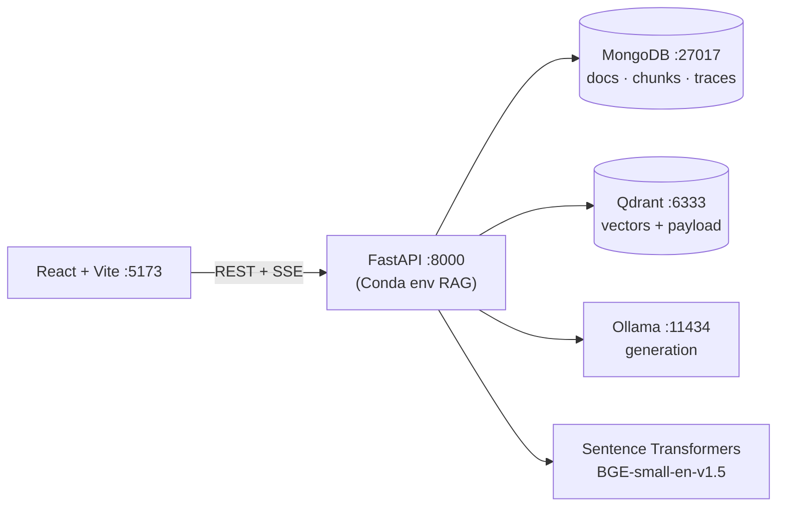

# HYU Compass

**An evidence-aware RAG assistant and pipeline workbench for new Hanyang University students.**

HYU Compass answers questions from official university documents that the team has collected.
Every answer shows its sources, and each source can be traced back to an exact passage. The
assistant abstains when the evidence is missing. HYU Compass is also a **workbench**: every
stage of the RAG pipeline is configurable from the UI, and each run shows that stage's real
input, output, parameters and measured latency.

> The repository ships with five **synthetic** sample documents (`data/samples/`) for
> development. They are not official HYU policy. Put real, approved documents in `data/raw/`.

## Features

- **Evidence-aware answers:** `[S1]`-style citations resolve to document, section, page and character span. Span re-reads are verified. "Cited" sources are kept apart from "retrieved but not cited" ones. An explicit `insufficient_evidence` outcome is returned when the evidence can't support an answer.
- **Rich metadata:** campus, audience, document type, academic year and dates are stored in MongoDB with provenance (`declared` vs `rule`). Native Qdrant payload filtering is driven by constraints detected in the question.
- **Interactive workbench:** 21 registered stages (6 offline, 15 online). Methods and hyperparameters come from one backend registry, which the UI turns into controls and validates server-side. The workbench also covers presets, JSON import/export and per-request execution traces streamed live over SSE.
- **Reproducible indexing:** deterministic document, chunk and revision IDs; versioned Qdrant collections; verification before publishing; atomic alias switch; vector reuse for unchanged chunks.
- **Fully local:** FastAPI (Conda env `RAG`), MongoDB and Qdrant in Docker, Sentence Transformers (`BAAI/bge-small-en-v1.5`), and Ollama for generation. No cloud APIs.

Implemented vs. planned methods are listed in [docs/RAG_PIPELINE.md](docs/RAG_PIPELINE.md#part-3--online-stages-one-question).

## Architecture



| Layer | Technology |
|---|---|
| Backend | Python 3.13 (Conda `RAG`), FastAPI, Pydantic v2, PyMongo, qdrant-client, Sentence Transformers, HTTPX, pytest |
| Frontend | React 19, TypeScript, Vite 7, Tailwind CSS 4, Radix primitives (shadcn-style), lucide-react, react-markdown, react-resizable-panels, Vitest |
| Data | MongoDB 8.0.32, Qdrant v1.19.0 (Docker Compose, named volumes, localhost only) |
| LLM | Ollama native API (`/api/tags`, `/api/show`, `/api/chat`) |

## Requirements

- Conda with the existing environment **`RAG`** (Python 3.13). Do not create another environment.
- Docker Desktop (Compose v2)
- Ollama with at least one chat model (e.g. `qwen3:4b`)
- Node.js ≥ 20 and npm
- ~1 GB disk for the BGE model (downloaded on first use from Hugging Face, then cached)

## Quick start

### 0. One-time setup

```bash
conda activate RAG
python -m pip install -r backend/requirements.txt
cp .env.example .env                 # Docker credentials; change the password
cp backend/.env.example backend/.env # backend settings; MONGODB_URI must use the same password
```

### Terminal 1 — databases

```bash
docker compose up -d
docker compose ps        # both services "running"; mongodb "healthy"
```

Stop with `docker compose down`. Data persists in the named volumes `hyu-compass_mongodb_data`
and `hyu-compass_qdrant_data`. **`docker compose down -v` deletes them.** Volumes are local to
each developer's Docker installation, so teammates build their own index (same files and settings
give the same revision ID).

### Terminal 2 — Ollama

```bash
ollama list              # already running? (the macOS app runs the server) — then skip `serve`
ollama serve             # only if nothing is listening on 127.0.0.1:11434
ollama pull qwen3:4b     # if you have no model yet (~2.5 GB)
```

Set `OLLAMA_CHAT_MODEL=qwen3:4b` in `backend/.env` to make it the default. Otherwise the first
installed model is used, and you can pick any installed model in the UI (Generation → Model).

### Terminal 3 — backend

```bash
conda activate RAG
cd backend
python -m uvicorn app.main:app --reload
```

API: <http://127.0.0.1:8000> · Swagger: <http://127.0.0.1:8000/docs>

### Ingest documents

```bash
conda activate RAG
python scripts/ingest.py --path data/samples    # synthetic sample corpus
python scripts/ingest.py --path data/raw        # your real documents
python scripts/verify_index.py
```

You can also rebuild from the UI: **Index & Documents → Rebuild**.

### Terminal 4 — frontend

```bash
cd frontend
npm ci                   # or `npm install` when changing dependencies
npm run dev
```

Open <http://127.0.0.1:5173> and try a first question, for example *"How many credits can a
first-year student register for?"*. Then click the activity icon under the answer to inspect
every stage in the **Execution** tab.

### Without Docker (fallback)

Qdrant can run embedded with `QDRANT_PATH=../data/qdrant_local` in `backend/.env`. This is exact
search in a single process: stop the API before running CLI scripts, or ingest through the UI.
MongoDB has no embedded mode and still needs Docker (or a local `mongod`).

## Tests

```bash
conda activate RAG
cd backend && python -m pytest         # 80 tests, no Docker/Ollama needed
cd frontend && npm run typecheck && npm test && npm run build
python scripts/evaluate.py --questions data/eval/sample_questions.jsonl   # retrieval ablation
```

## Troubleshooting

| Problem | Fix |
|---|---|
| `docker: command not found` | Install Docker Desktop and start it |
| MongoDB `Authentication failed` | `MONGODB_URI` in `backend/.env` must match `MONGO_ROOT_*` in `.env`; the root user is only created on the **first** start of an empty volume |
| UI says "Cannot reach the HYU Compass API" | Is uvicorn running on port 8000? |
| "No active index" | Run `python scripts/ingest.py --path data/samples` |
| Ollama dot is red | `ollama serve`, or open the Ollama app; check `curl 127.0.0.1:11434/api/tags` |
| "reasoning used the whole output budget" | Thinking model: raise Generation → *Max output tokens* to 2048 |
| BGE download fails | Needs internet once; afterwards the Hugging Face cache is used (`HF_HUB_OFFLINE=1` forces offline) |
| Port already in use | Change `MONGO_PORT` / `QDRANT_HTTP_PORT` in `.env` and the matching URLs in `backend/.env` |

More in [docs/DEVELOPER_GUIDE.md › Debugging](docs/DEVELOPER_GUIDE.md#debugging).

## Documentation

| Document | Read it to… |
|---|---|
| [docs/ARCHITECTURE.md](docs/ARCHITECTURE.md) | understand components, data flow, versioning, events (Mermaid diagrams) |
| [docs/RAG_PIPELINE.md](docs/RAG_PIPELINE.md) | learn each stage from fundamentals, with code locations |
| [docs/HYPERPARAMETERS.md](docs/HYPERPARAMETERS.md) | know what every parameter does and its trade-offs |
| [docs/DATABASE_AND_EVALUATION.md](docs/DATABASE_AND_EVALUATION.md) | see the MongoDB/Qdrant schemas, verification, metrics and **measured results** |
| [docs/DEVELOPER_GUIDE.md](docs/DEVELOPER_GUIDE.md) | set up, add methods or stages, test, debug |
