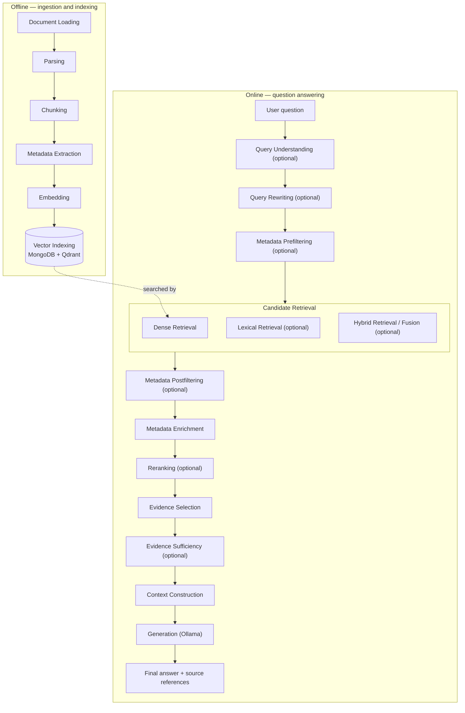
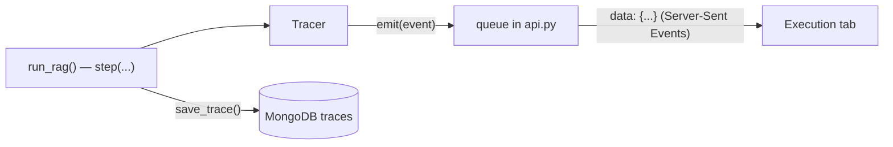

# 02 · The RAG Architecture

This document explains HYU Compass from zero, in the terms of our course *Design of Generative AI
Application Systems*: **what** each block does, **why** it exists, and **where** its code lives.

- How blocks are written (abstract classes) → [03_ABSTRACT_CLASSES.md](03_ABSTRACT_CLASSES.md)
- How methods and settings reach the UI → [04_METHOD_REGISTRY.md](04_METHOD_REGISTRY.md)

## The big picture

A RAG system has two workflows: **offline ingestion and indexing** (prepare the documents once)
and **online question answering** (every question). Each is a chain of **blocks**. A block has one
job, a defined input and a defined output.



Blocks marked *optional* are implemented but **off in the basic RAG (B0)**: switch them on in the
Configuration tab or choose an experiment preset. A switched-off block is skipped and shown as
skipped in the Execution tab. Adding further methods is our course work
([05_ADD_NEW_METHOD.md](05_ADD_NEW_METHOD.md)); measuring them is
[06_BENCHMARK_AND_EVALUATION.md](06_BENCHMARK_AND_EVALUATION.md).

### Where the code is

**One block = one folder, grouped by pipeline phase.** Each block folder holds the block's abstract
class in `base.py` and one file per algorithm. Related blocks live in the same **group folder**: e.g.
Dense Retrieval, Lexical Retrieval and Hybrid Fusion are all in `blocks/retrieval/`. The group folder
also decides the heading the UI shows above those blocks (`GROUPS` in `registry.py`).

```text
Sources/backend/app/
├── main.py  config.py  api.py  database.py  ollama.py  tracing.py
└── rag/
    ├── schemas.py       the data passed between blocks (Candidate, Evidence, FilterCriteria, …)
    ├── registry.py      THE list of blocks, methods and hyperparameters
    ├── presets.py       named experiment configurations (B0, O0–O8, R0–R14)
    ├── text.py          query-term coverage (Lesson 5), shared by a reranker and the gate
    ├── pipeline.py      run_ingestion(), index_documents() and run_rag(): call the blocks in order
    └── blocks/
        ├── pipeline_block.py         what every block has in common (self.params, self.services)
        │
        ├── ingestion/                OFFLINE · "Ingestion"
        │   ├── document_loading/     base.py · local_loader.py ✓ · web_loader.py
        │   ├── parsing/              base.py · basic_parser.py ✓
        │   ├── chunking/             base.py · section_chunker.py ✓ · fixed_chunker.py ✓ · recursive_chunker.py ✓
        │   │                         · whole_document.py ✓ · semantic_chunker.py
        │   ├── metadata_extraction/  base.py · basic_extractor.py ✓ · llm_extractor.py
        │   ├── embedding/            base.py · bge_embedder.py ✓ · minilm_embedder.py ✓ · ollama_embedder.py
        │   └── vector_indexing/      base.py · qdrant_indexer.py ✓
        │
        ├── query_processing/         ONLINE · "Query Processing"
        │   ├── query_understanding/  base.py · stated_criteria.py ✓ · llm_understanding.py
        │   └── query_rewriting/      base.py · llm_rewriter.py ✓ · multi_query.py ✓ · hyde.py ✓
        │
        ├── metadata_filtering/       ONLINE · "Metadata Filtering"
        │   ├── metadata_prefiltering/   base.py · qdrant_prefilter.py ✓     (runs BEFORE retrieval)
        │   └── metadata_postfiltering/  base.py · candidate_postfilter.py ✓ (runs AFTER retrieval)
        │
        ├── retrieval/                ONLINE · "Candidate Retrieval"
        │   ├── dense_retrieval/      base.py · qdrant_cosine.py ✓
        │   ├── lexical_retrieval/    base.py · bm25.py ✓
        │   └── hybrid_fusion/        base.py · rrf.py ✓
        │
        ├── evidence/                 ONLINE · "Evidence"
        │   ├── metadata_enrichment/  base.py · mongodb_enrichment.py ✓
        │   ├── reranking/            base.py · coverage_reranker.py ✓ · cross_encoder.py ✓ · rankgpt.py ✓
        │   │                         · metadata_reranker.py
        │   ├── evidence_selection/   base.py · top_k_selector.py ✓ · token_budget_selector.py ✓
        │   └── evidence_sufficiency/ base.py · sufficiency_checker.py ✓
        │
        └── grounded_generation/      ONLINE · "Grounded Generation"
            ├── context_construction/ base.py · standard_context.py ✓
            └── generation/           base.py · ollama_generator.py ✓
```

The folders show **where code lives**; `run_rag()` decides **when it runs**. The two metadata
filtering blocks share a folder because they solve the same problem, but prefiltering runs before
retrieval and postfiltering after it.

✓ = implemented and tested. The few files without ✓ (web loader, semantic chunker, LLM metadata
extraction, Ollama embeddings, LLM query understanding, metadata-aware reranking) are **teaching
skeletons** with TODO steps that raise `NotImplementedError`; the UI shows them greyed out.
Next to the app, `Sources/evaluation/` measures every method on BEIR with the same code —
see [06_BENCHMARK_AND_EVALUATION.md](06_BENCHMARK_AND_EVALUATION.md).

---

## Part A — Offline: ingestion and indexing (`run_ingestion()` in `rag/pipeline.py`)

| Block (folder) | Working method | What it does |
|---|---|---|
| Document Loading (`ingestion/document_loading/`) | `local_loader.py` · `LocalFolderLoader` | finds PDF, TXT, Markdown, HTML files; lists skipped ones |
| Parsing (`ingestion/parsing/`) | `basic_parser.py` · `BasicDocumentParser` | file → title + **sections** (heading, text, page) |
| Chunking (`ingestion/chunking/`) | `section_chunker.py` · `SectionTokenChunker` (default); also fixed-size, recursive, whole-document | sections → chunks of at most `chunk_size` tokens, each with its source span |
| Metadata Extraction (`ingestion/metadata_extraction/`) | `basic_extractor.py` · `BasicMetadataExtractor` | title, language, fields the file declares (front matter) |
| Embedding (`ingestion/embedding/`) | `bge_embedder.py` · `SentenceTransformerEmbedder` (default); also `minilm_embedder.py` | text → 384-number vector (BAAI/bge-small-en-v1.5) |
| Vector Indexing (`ingestion/vector_indexing/`) | `qdrant_indexer.py` · `QdrantMongoIndexer` | text → MongoDB, vectors + metadata payload → Qdrant; writes a **manifest** |

**Parsing** splits at headings ("Credit Limits", "How to Apply"), so an answer can say *where* a
fact came from. PDFs get one section per page, so the page number is kept.

**Chunking.** An embedding squeezes a text into 384 numbers. Squeeze a 20-page handbook into one
vector and every specific fact is averaged away, and the model reads at most 512 **tokens** anyway.
So documents become **chunks**: a section with at most `chunk_size` tokens stays one chunk, and a
longer one becomes windows that overlap by `chunk_overlap` tokens:

```text
chunk_size = 6, chunk_overlap = 2   (each window starts 6 − 2 = 4 tokens after the previous one)
tokens:   t1 t2 t3 t4 t5 t6 t7 t8 t9 t10
chunk 1:  t1 t2 t3 t4 t5 t6
chunk 2:              t5 t6 t7 t8 t9 t10      ← t5 t6 appear twice (the overlap)
```

Chunk size and overlap are **ingestion** settings: they only change after **re-indexing**
(Configuration tab → Ingestion → *Re-index*, or, from `Sources/`, `python scripts/ingest.py --chunk-size 128 …`).

**Embedding.** Texts with similar meaning get vectors pointing in similar directions. The **same**
model must embed documents and questions, because each model has its own "coordinate system".
Dense retrieval refuses to search if the stored vector size doesn't match.

**Vector Indexing — MongoDB and Qdrant.** MongoDB stores readable records (`documents`, `chunks`
with their text, `traces`). Qdrant stores one **point** per chunk: the vector plus the payload
`{chunk_id, doc_id}` and the document's metadata fields (lowercase lists, used by prefiltering).
After indexing, `index_documents()` stores a **manifest** (how the index was built: settings, embedding
model and revision, counts, timings, HNSW status) in the database's `manifest` collection. They are linked by IDs: the Qdrant point ID *is* the `chunk_id`, which comes
from `doc_id` + position + text (`make_chunk_id` in `rag/schemas.py`). So re-ingesting the same
files gives the same IDs.

---

### The HYU snapshot index (with AAES applicability tags)

`scripts/ingest_snapshot.py` indexes a frozen crawl snapshot as its own **index revision**
(`hyu_bench_<id>` in MongoDB, `bench_<id>` in Qdrant). The app's default index is never touched.

1. **BUILD**: `app/rag/snapshot.py` turns each snapshot row into a ParsedDocument.
   - Headers are English only; a Korean heading stays in the body.
   - A section is cut at a span boundary before it grows past 320 tokens, so table rows stay whole.
   - The chunker is `section_tokens` at 320/48 bge tokens.
   - `index_documents(..., tag_input=...)` tags every chunk with `applicability_extractor`.
     - Rules come first. The LLM is asked only for untagged chunks that contain a cue word, and its
       answers are cached in `Report/data/HYU/cache/llm_tags.jsonl`.
     - Tags are stored in two places:
       - MongoDB chunk: `applicability` (the full `ChunkCondition`) and `vocabulary_version`;
       - Qdrant payload: `app_<attribute>`, `app_scope`, `app_campus`, `app_term`, `app_superseded`.
2. **VERIFY**: re-reads both databases and runs pass/fail checks:
   - counts, dimension 384, unique IDs;
   - at most 512 embedded tokens and 0 truncated;
   - valid tags on every chunk, 0 unmasked e-mails, no Hangul in headers;
   - the default index is unchanged.

   Writes `Report/results/index_reports/<index_id>.{json,md}`. The status becomes `verified` only
   if every check passes.
3. **PUBLISH** (`--publish`): marks a verified index `published`. Select it with `index_id`
   (`GET /api/indexes`).

## Part B — Online: question answering (`run_rag()` in `rag/pipeline.py`)

| # | Block (folder) | Status | Input → Output |
|---|---|---|---|
| 1 | Query Understanding (`query_processing/query_understanding/`) | optional (stated criteria) | question → `QueryAnalysis` (intent, `FilterCriteria`) |
| 2 | Query Rewriting (`query_processing/query_rewriting/`) | optional (LLM rewrite, multi-query, HyDE) | question → `RewrittenQuery` |
| 3 | **Metadata Prefiltering** (`metadata_filtering/metadata_prefiltering/`) | optional | `FilterCriteria` → `RetrievalFilter` (a predicate) |
| 4 | Dense Retrieval (`retrieval/dense_retrieval/`) | **on by default** | query + predicate → `RetrievalResult` (Top K `Candidate`s) |
| 5 | Lexical Retrieval (`retrieval/lexical_retrieval/`) | optional (BM25) | query + predicate → `RetrievalResult` |
| 6 | Hybrid Retrieval / Fusion (`retrieval/hybrid_fusion/`) | optional (RRF) | two `RetrievalResult`s → one |
| 7 | **Metadata Postfiltering** (`metadata_filtering/metadata_postfiltering/`) | optional | `Candidate`s + `FilterCriteria` → `PostfilterResult` |
| 8 | Metadata Enrichment (`evidence/metadata_enrichment/`) | **on** | `Candidate`s → `Evidence` (text, title, section, page) |
| 9 | Reranking (`evidence/reranking/`) | optional (coverage, cross-encoder, RankGPT) | `Evidence` → reordered `Evidence` |
| 10 | Evidence Selection (`evidence/evidence_selection/`) | **on** (Top-K; or token budget) | `Evidence` → the evidence for the prompt |
| 11 | Evidence Sufficiency (`evidence/evidence_sufficiency/`) | optional (threshold gate) | `Evidence` → `SufficiencyDecision` |
| 12 | Context Construction (`grounded_generation/context_construction/`) | **working** | question + `Evidence` → `PromptContext` (`[E1]` labels) |
| 13 | Generation (`grounded_generation/generation/`) | **working** | `PromptContext` → `GenerationResult` (streamed) |

Steps 4–6 together are **Candidate Retrieval**. The UI groups them under that name. "Optional" stages
are off in B0 (the basic RAG) and can be switched on per question in the Configuration tab, or all at
once with an **experiment preset** (`Sources/backend/app/rag/presets.py`, e.g. *R2 — Hybrid RRF*).

### Before retrieval: query understanding and rewriting

**Query Understanding → Stated criteria** turns what the student states ("I study at ERICA") into
`FilterCriteria`; both metadata filters use them. **Query Rewriting** changes only what is
*searched*, never the question that is answered:

- **LLM rewrite** — one concise search query. A deterministic check (`validate_rewrite()` in
  `query_rewriting/base.py`) makes sure every number, date, quoted phrase, name and negation is kept;
  otherwise the original question is searched. The trace's *Details* tab shows the rejected rewrite.
- **Multi-query** — the LLM writes several queries; each retriever runs **once per query** and the
  rankings are merged with RRF. More searches, more LLM tokens.
- **HyDE** — the LLM writes a *hypothetical* answer passage; dense retrieval embeds that passage
  (like a document) instead of the question. The passage may be wrong: it is only a search vector and
  is never evidence or a source.

### Candidate retrieval: dense, lexical, hybrid

**Dense Retrieval** (`QdrantDenseRetriever`) embeds the question and asks Qdrant for the Top K
chunk vectors with the highest **cosine similarity**:

```text
cos(q, c) = (q · c) / (|q| × |c|)        1.0 = same direction, 0.0 = unrelated
```

Our vectors have length 1, so this is simply the dot product. `search_mode` *exact* compares the
question with every vector; *hnsw* walks Qdrant's HNSW graph (approximate, faster on big indexes) and
refuses to run if the index has no graph.

**Lexical Retrieval** (`BM25Retriever`) ranks chunks by shared *words*: rare words count more
(idf), repeated words saturate (`k1`), long chunks are penalized (`b`). It indexes the same
"heading + text" as dense retrieval. It is strong for exact terms like "TOPIK" or "add/drop", where
meaning-based search can be vague. BM25 scores are unbounded — never compare them with cosine values.
**Hybrid Retrieval** (`ReciprocalRankFusion`) merges both candidate lists by rank only:
`score = Σ 1/(k + rank)` with k = 60; each fused candidate keeps its original ranks in `scores`.

**Top K** (default 5): a larger K makes it more likely the right chunk is a candidate, but the model
also gets more unrelated text.

### Metadata filtering: Prefiltering and Postfiltering

Some documents only apply to some students, e.g. an ERICA dormitory notice. **Metadata filtering**
enforces such *eligibility* conditions. There are two placements, and they behave differently:

**Prefiltering** applies the eligibility conditions *during* candidate retrieval: the retriever
searches **only within the eligible subset**. The block `metadata_filtering/metadata_prefiltering/` builds a
predicate (`RetrievalFilter`, e.g. `{"campus": ["ERICA", "ALL"]}`). The runner passes it **into**
the retrievers, and `QdrantDenseRetriever` turns it into a Qdrant `query_filter`, so Qdrant ranks only
eligible chunks.

**Postfiltering** first retrieves a limited candidate list, then removes ineligible candidates
(`metadata_filtering/metadata_postfiltering/`). It works only on what was already retrieved.

```text
PREFILTERING                                   POSTFILTERING
eligible subset ──► search ──► Top 5           all chunks ──► search ──► Top 5 ──► remove ineligible ──► 0–5 left
(always up to 5 eligible results)              (eligible chunks ranked 6th or lower are never seen)
```

**Candidate starvation.** Postfiltering cannot recover relevant documents that were excluded from
the initial candidate pool.

*Synthetic example, in the style of the lecture's laptop-loan case:* an ERICA student asks *"Can I
borrow a laptop?"*. The Top 5 candidates are all Seoul library rules, because there are more of
them and they use the same words. The ERICA rule is ranked 7th. Postfiltering removes all five
Seoul chunks and leaves **nothing**, although the right answer exists. With prefiltering, the
search runs only over ERICA and university-wide chunks, so the ERICA rule ranks first.

If postfiltering leaves no candidates, the system must abstain. It must **not** quietly drop the
student's conditions to fill the list.

| Prefiltering | Postfiltering | Meaning |
|---|---|---|
| Off | Off | Baseline retrieval (today) |
| On | Off | Search only eligible sources |
| Off | On | Filter the retrieved candidates afterwards |
| On | On | Retrieval-time eligibility, plus an extra check afterwards |

Both blocks read the **same** `FilterCriteria` (from Query Understanding → *Stated criteria*) and
build the **same** predicate with `FilterCriteria.to_filter()`, so they cannot contradict each other.
The criteria only come from what the student actually states; the system never invents user
attributes. Policy settings (both blocks): documents that do not state a field stay eligible
(`include_unknown`), and campus-wide documents (`campus: ALL`) count for every campus. Dense
retrieval sends the predicate to Qdrant; BM25 applies the same predicate while ranking.

### Metadata Enrichment, Reranking, Evidence Selection

**Metadata Enrichment** (`MongoChunkLookup`): Qdrant returned only IDs and scores, so the text,
section, page and document title are loaded from MongoDB. A chunk in Qdrant that is missing in
MongoDB is an error: re-index.

**Reranking** reorders the top `rerank_depth` candidates (the rest keep their order behind them):
*query-term coverage* (Lesson 5: share of question words in the chunk), a *cross-encoder*
(`ms-marco-MiniLM-L6-v2` reads question and chunk **together** — more accurate, one model call per
pair), or *RankGPT* (a local LLM orders the passages; its output is validated: missing, duplicate and
invalid IDs are detected, retried once, then repaired or the original order is kept).

**Evidence Selection** decides how much of the retrieved evidence goes into the prompt. The
baseline is **Top-K** (`TopKSelector`, default): the list is already best first, so it simply keeps
the first `top_k` chunks (default 3) and drops the rest. Retrieval fetches a few more candidates
(Dense Retrieval Top K = 5) than the prompt receives, so later blocks such as reranking have room to
reorder before the cut. The alternative **Token budget** (`TokenBudgetSelector`) keeps chunks in rank
order until `max_evidence_tokens` (default 2000) would be exceeded; switch to it in the
Configuration tab to compare the two.

### Evidence Sufficiency and Abstention

**Evidence Sufficiency** (`ScoreThresholdChecker`, optional) asks: is this evidence good enough to
answer at all? It proceeds when a signal reaches a threshold — by default Lesson 5's best query-term
coverage ≥ 0.30 (or the best dense similarity). It is a **heuristic**: a high score means "looks
related", not "supports the answer". If it says no, the system **abstains**: it does not call the
model and answers *"I could not find enough information…"*. Even without the gate, the system
abstains in two cases:
- no evidence was retrieved → the model is not called;
- the model replies `INSUFFICIENT_CONTEXT` (the prompt tells it to when the evidence is missing).

### Context Construction and Grounded Generation

**Context Construction** (`StandardContextBuilder`) writes the evidence into the prompt as numbered
blocks, together with the grounding rules (`SYSTEM_PROMPT` in
`grounded_generation/context_construction/standard_context.py`):

```text
[E1] Course Registration Handbook (Sample) — Credit Limits
Undergraduate students may register for between 12 and 18 credits per regular semester …

[E2] Course Registration Handbook (Sample) — Registration Periods
Course registration in this sample handbook has three periods. …
```

**Grounded generation** (`OllamaGenerator`): the local Ollama model answers **only from the
evidence**, writes the label of each block it uses (like `[E1]`), and streams its answer to the
browser. `app/ollama.py` uses `GET /api/tags` (installed models) and `POST /api/chat`. Settings:
model, temperature (randomness, not knowledge) and max generated tokens. Hidden "thinking" of models
like `qwen3` is removed and never shown.

### Source references (source attribution)

After generation, `attach_sources()` in `rag/pipeline.py` turns each evidence block into a
**source reference**: document title, section, page, chunk ID and an excerpt. A reference is marked
*cited* if the answer contains its `[E#]` label. Labels that match no evidence block are removed,
so the UI never shows a source that doesn't exist.

This is **attribution**: it tells you which retrieved text the answer points to. It does **not**
verify that each sentence is true, and the project has no claim-verification stage. It is also
**not Postfiltering**. Postfiltering removes *ineligible candidates before generation*; resolving
`[E#]` labels happens *after generation* and only links the answer to the evidence it was given.

### Four different questions

| Concept | Question | Where it is decided |
|---|---|---|
| **Relevance** | Does this chunk match the question? | candidate retrieval scores, reranking |
| **Eligibility** | Does this document apply to this student (campus, audience, year)? | metadata prefiltering / postfiltering |
| **Evidence sufficiency** | Is the selected evidence enough to answer? | evidence sufficiency (+ abstention) |
| **Source attribution** | Which retrieved text does the answer point to? | `[E#]` labels → source references |

⚠️ A highly *relevant* chunk can be *ineligible* (wrong campus). An eligible, relevant chunk can
still be *insufficient*. A well-*attributed* sentence can still be wrong. Keep these apart in
reports and experiments.

---

## How the Execution tab gets its data

Every block runs inside `tracer.stage(...)` (`app/tracing.py`). The tracer records the block's
**method, parameters, real input, real output and measured time**, and streams each update to the
browser:



```text
data: {"type": "started", "request_id": "…", "config": {...the methods and parameters used...}}
data: {"type": "stage", "stage": {"stage_id": "dense_retrieval", "method_id": "qdrant_cosine", "status": "completed",
                                  "input": {"query": "…", "prefilter": null}, "output": {"candidates": [...]}, "duration_ms": 12.1}}
data: {"type": "stage", "stage": {"stage_id": "metadata_postfiltering", "status": "skipped", "summary": "Not implemented yet."}}
data: {"type": "answer_delta", "text": "The maximum"}
data: {"type": "done", "trace": {...answer, outcome, sources, every stage — also saved in MongoDB...}}
```

A **skipped** stage really did not run: no input, no output, no time. Each answer keeps its
`request_id`, so the activity icon under an answer always opens *that* answer's trace.

---

## A complete worked example (a real run)

Sample documents indexed (5 documents, 23 chunks), preset B0 (default settings), model `qwen3:4b`
with *Max generated tokens* 2048.

**Question:** *How many credits can a first-year student register for?*

| Block | Method | What happened |
|---|---|---|
| Query Understanding, Query Rewriting, Metadata Prefiltering | — | skipped: switched off |
| Dense Retrieval | `qdrant_cosine` | Top K 5, no prefilter; best: chunk `165c3154…`, similarity **0.8354** |
| Lexical Retrieval, Hybrid Fusion, Metadata Postfiltering | — | skipped: switched off |
| Metadata Enrichment | `mongodb_lookup` | 5 chunk texts loaded from MongoDB |
| Reranking | — | skipped |
| Evidence Selection | `top_k` | Top K 3: the 3 best of the 5 chunks are kept |
| Evidence Sufficiency | — | skipped |
| Context Construction | `standard_context` | 3 evidence blocks, **242 tokens** |
| Generation | `ollama_chat` | streamed answer |

> **Answer:** 18 credits **[E1]**
> **Source:** E1 · Course Registration Handbook (Sample) · Credit Limits

Almost all the time is spent in generation. The first question after starting the backend also
loads the embedding model (a few seconds). Timings differ on every computer.
