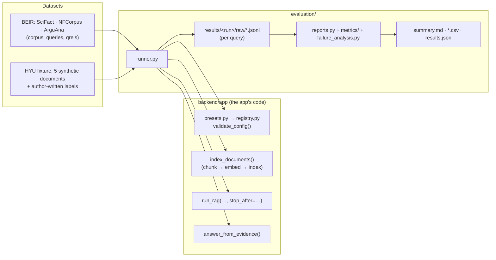

# 06 · Benchmarks and Evaluation

This guide explains how we **measure** HYU Compass: which datasets we use, which baselines we compare,
how to run every experiment with one command, and how to read the results. Read
[02_RAG_ARCHITECTURE.md](02_RAG_ARCHITECTURE.md) first: every method measured here is a block of the
same pipeline the app runs.

> **One implementation of every algorithm.** The benchmark runner imports the app's registry,
> presets and `run_rag()` (from `backend/app/`). There is no second BM25, no second retriever, no
> second pipeline. If a method works in the UI, the benchmark measures exactly that code.

---

## 1. What we measure, in one picture



The runner never needs the browser or FastAPI. It needs MongoDB and Qdrant (Docker) for indexes
and Ollama only for LLM-based methods and generation.

---

## 2. BEIR and its datasets

**BEIR** (Thakur et al., 2021) is a collection of *retrieval* benchmarks. Each dataset has:

| File | Content |
|---|---|
| `corpus.jsonl` | the documents: `_id`, `title`, `text` |
| `queries.jsonl` | the queries: `_id`, `text` |
| `qrels/test.tsv` | **relevance judgments**: `query-id  corpus-id  score` |

**qrels** ("query relevance judgments") say which documents people judged relevant to each query
(score > 0 = relevant; NFCorpus uses grades 1 and 2). A document that is *not* in the qrels was
simply never judged — it is not necessarily irrelevant.

| Dataset | Documents | Test queries | What a "query" is | Relevance |
|---|---|---|---|---|
| **SciFact** | 5,183 abstracts | 300 | a scientific claim; find abstracts that support/refute it | binary, ~1.1 relevant per query |
| **NFCorpus** | 3,633 medical articles | 323 | a nutrition question; find related articles | graded (1, 2), ~38 relevant per query |
| **ArguAna** | 8,674 arguments | 1,406 | an argument; find its best counter-argument | binary, 1 relevant per query |

**Why BEIR is a retrieval benchmark.** The qrels judge documents, not answers. They tell us whether
the right documents were *retrieved*, but not whether a generated *answer* is correct. Answer
quality therefore needs separate, human annotations (section 9) — we never compute it from qrels.

**Download** (once; files stay in `evaluation/datasets/`, which is not committed to Git). Each
archive's MD5 checksum is checked against the value published in the BEIR README:

```bash
conda activate RAG
python -m evaluation.runner --download scifact,nfcorpus,arguana
```

Licenses: SciFact CC BY-NC 2.0, NFCorpus and ArguAna CC BY-SA 4.0 (recorded in each `SOURCE.json`).

### Splits and tuning

We report the **test** split. ArguAna has no development split, so **no setting was tuned on any
test labels**: every hyperparameter is the preset default written down before the runs. When the
team starts tuning (for the proposed approach), use SciFact `train` or NFCorpus `dev`
(`--split dev`) and freeze the values before running `test`.

---

## 3. Two evaluation protocols (always reported separately)

| | Protocol **A** — BEIR-native | Protocol **B** — HYU-style chunked |
|---|---|---|
| Retrieval unit | one original BEIR document | a chunk (section-aware, 256/32 tokens by default) |
| Index | chunker `whole_document` | the offline preset's chunker |
| Ranking scored | documents as retrieved | chunks → their BEIR document, **at the rank of its first chunk**, duplicates removed |
| Depth | 100 documents | 600 chunks retrieved, so up to 100 distinct documents can be ranked |
| Limitation | the embedder reads only the first 512 tokens (BGE); counted as `truncated_by_embedder` | not the BEIR leaderboard setting |

Both use the original BEIR document IDs. Every report table names its protocol. The depth needed
for MAP@100 / Recall@100 is a *benchmark* setting: the app itself still retrieves Top 5 and sends the
Top 3 evidence chunks to the model. When a query's chunk list yields fewer than 100 distinct
documents, the report counts it in `depth_shortfall_queries`.

Like BEIR, the evaluator removes a query's own ID from its ranking (`ignore_identical_ids`):
1,298 ArguAna queries are themselves documents of the corpus. In Protocol A, which retrieves exactly 100
documents, those queries are then scored on 99 documents (reported as `depth_shortfall_queries`; it
only affects rank 100).

---

## 4. The baselines

All presets live in `backend/app/rag/presets.py`. A preset only stores method IDs and parameter
values; the registry validates it. You can select every preset in the UI (**Configuration →
Experiment preset**) and run it in the benchmark.

### B0 — the frozen basic baseline

`B0_BASIC_DENSE_RAG` is the original app: local loading, basic parsing, section-aware chunking
256/32, basic metadata, `BAAI/bge-small-en-v1.5` (384 dimensions, revision pinned), exact cosine
search Top 5, MongoDB enrichment, Top-3 evidence selection, standard context, Ollama generation and
`[E#]` source attribution. No rewriting, filtering, fusion, reranking or gate.

### Offline baselines (each needs its own index revision)

| Preset | Change vs O0 | Implemented in |
|---|---|---|
| O0 Section-aware 256/32 | — (same as B0) | `ingestion/chunking/section_chunker.py` |
| O1 Fixed-size 256/32 | windows ignore section boundaries | `ingestion/chunking/fixed_chunker.py` |
| O2 No overlap | overlap 0 | section chunker |
| O3 Small chunks | 128 tokens | section chunker |
| O4 Large chunks | 512 tokens | section chunker |
| O5 Recursive 256/32 | paragraph → line → sentence → word splits, merged | `ingestion/chunking/recursive_chunker.py` |
| O6 Alternative embedding | `sentence-transformers/all-MiniLM-L6-v2` | `ingestion/embedding/minilm_embedder.py` |
| O7 Exact search | index with a built HNSW graph, searched exactly | `retrieval/dense_retrieval/qdrant_cosine.py` (`search_mode: exact`) |
| O8 HNSW ANN | the same index, searched through the graph (`hnsw_ef` 100, `m` 16, `ef_construct` 100) | same file (`search_mode: hnsw`) |

All chunkers count **tokens with the embedding model's tokenizer** and record a source span for
every chunk (`full_text[start:end] == text`; the manifest reports invalid spans).

**Exact vs HNSW.** Qdrant only builds an HNSW graph for segments larger than
`indexing_threshold_kb` (default 20,000 KB ≈ 13,000 vectors); smaller collections are always
full-scanned. O7/O8 therefore build their shared index with `indexing_threshold_kb = 1`, and the
manifest records `hnsw_built` (indexed vectors = points). `search_mode: hnsw` **refuses** to run on an
index without a graph, so an "HNSW" number can never secretly be a full scan. ANN quality is reported
as the overlap of the HNSW top-k with the exact top-k on identical vectors and queries.

> On BEIR, O0 and O1 produce the same chunks: a BEIR document has a single section, so
> "respecting section boundaries" changes nothing. The difference only appears on documents with
> headings (e.g. the HYU Markdown files).

### Online baselines (all on the O0 index, exact search)

| Preset | What changes | Implemented in (`backend/app/rag/blocks/…`) | Main hyperparameters |
|---|---|---|---|
| R0 Dense | — (= B0; results shared) | `retrieval/dense_retrieval/qdrant_cosine.py` | `top_k`, `search_mode`, `hnsw_ef` |
| R1 BM25 | lexical retrieval only | `retrieval/lexical_retrieval/bm25.py` | `top_k`, `k1` 1.2, `b` 0.75 |
| R2 Hybrid RRF | dense + BM25, Reciprocal Rank Fusion | `retrieval/hybrid_fusion/rrf.py` | `rrf_k` 60, `top_k` |
| R2 matched budget | each branch at half depth (same total as B0) | same | — |
| R3 Coverage rerank | Lesson 5 query-term coverage | `evidence/reranking/coverage_reranker.py` | `rerank_depth` |
| R4 Cross-encoder | `cross-encoder/ms-marco-MiniLM-L6-v2` | `evidence/reranking/cross_encoder.py` | `rerank_depth`, `batch_size`, `device` |
| R5 Hybrid + CE | R2 then R4 (a preset, no new code) | — | — |
| R6 Query rewriting | one LLM rewrite, validated, else the original | `query_processing/query_rewriting/llm_rewriter.py` | `model`, `temperature`, `max_tokens` |
| R7 Multi-query | question + 3 LLM queries, each searched, merged with RRF | `query_processing/query_rewriting/multi_query.py` | `num_queries`, `include_original`, `rrf_k` |
| R8 HyDE | embed an LLM-written hypothetical passage | `query_processing/query_rewriting/hyde.py` | `model`, `max_tokens` |
| R9 Prefiltering | stated criteria applied **inside** retrieval | `metadata_filtering/metadata_prefiltering/qdrant_prefilter.py` | `include_unknown`, `include_campus_wide` |
| R10 Postfiltering | the same predicate applied **after** retrieval | `metadata_filtering/metadata_postfiltering/candidate_postfilter.py` | same |
| R11 Token budget | evidence up to 2,000 tokens instead of Top 3 | `evidence/evidence_selection/token_budget_selector.py` | `max_evidence_tokens`, `deduplicate` |
| R12 Sufficiency gate | abstain when best query coverage < 0.30 | `evidence/evidence_sufficiency/sufficiency_checker.py` | `signal`, `threshold`, `on_missing_signal` |
| R13 RankGPT | an LLM orders the top 20 passages | `evidence/reranking/rankgpt.py` | `model`, `rerank_depth`, `max_words` |
| R14 Full advanced | rewrite → hybrid RRF → cross-encoder → Top 3 → gate → generation | presets only | — |

The criteria for R9/R10 come from **Query Understanding → Stated criteria**
(`query_processing/query_understanding/stated_criteria.py`): the campus/audience/year/type the
student states. Both filters build their predicate with the same `FilterCriteria.to_filter()`.

`PROPOSED_APPROACH` is reserved and disabled until the team designs its own method (section 12).

---

## 5. Running experiments

Start MongoDB and Qdrant (`./start.sh` or `docker compose up -d`) and, for LLM methods, Ollama.
Everything below runs from the `hyu-compass/` folder with `conda activate RAG`.

```bash
# 1. Check every configuration, dataset and model — nothing heavy is loaded
python -m evaluation.runner --suite all --dry-run

# 2. Fast end-to-end check: 5 queries on a small corpus slice (separate "_smoke" indexes, run "smoke")
python -m evaluation.runner --suite all --smoke

# 3. Everything that applies (builds the index revisions on first use; several hours on a laptop)
python -m evaluation.runner --suite all

# Only some of it
python -m evaluation.runner --suite offline                    # O0–O8 (+ Protocol A index)
python -m evaluation.runner --suite retrieval                  # R0–R14 on BEIR + the HYU fixture
python -m evaluation.runner --suite generation                 # Llama 2 vs Qwen 3.5
python -m evaluation.runner --suite retrieval --dataset scifact
python -m evaluation.runner --suite retrieval --experiment R2_HYBRID_RRF,R4_CROSS_ENCODER

# An interrupted run: continue where it stopped (finished queries are not repeated)
python -m evaluation.runner --suite all --resume
# Recompute (and rebuild the indexes of) selected tasks
python -m evaluation.runner --suite retrieval --experiment R1_BM25 --force

# Rebuild the reports from saved results — no model is run
python -m evaluation.reports --run-id main
```

Options: `--split` (default `test`), `--run-id` (results folder, default `main`),
`--max-queries N` (limit per task; recorded in the manifest).

**What `--suite all` runs** is declared in `evaluation/configs/` *before* running:

| File | Declares |
|---|---|
| `offline.yaml` | the 10 offline experiments × 3 datasets, depths |
| `online.yaml` | the online experiments × protocols × datasets, which are `llm` (run on the first 100 test queries), which are NOT_APPLICABLE and why, the frozen auxiliary LLM, the HYU fixture |
| `generation.yaml` | the two backbones, the shared generation settings, the cases |

It is a declared matrix, not every combination: offline methods are compared with the same online
method (R0), online methods on the same index (O0).

Each task ends with a status:

| Status | Meaning |
|---|---|
| `COMPLETED` | ran; per-query results saved |
| `NOT_APPLICABLE` | the data cannot measure it (e.g. prefiltering on BEIR: no eligibility metadata) |
| `SHARED` | identical configuration to another task (R0 = B0) |
| `BLOCKED` | a model or service is missing (the reason says which, e.g. `ollama pull qwen3.5:4b`) |
| `FAILED` | an error (the message is saved); other tasks continue |

### Index revisions

Benchmark indexes never touch the app's index. Each lives in its own MongoDB database
`hyu_bench_<id>` and Qdrant collection `bench_<id>`, e.g. `scifact_o3`. Its **manifest** (in the
database's `manifest` collection) records the corpus checksum, the offline configuration, the
embedding contract (model, revision, dimension, prefixes, device), chunk/document counts, span
validity, truncation, the HNSW status and the build timings. An index is reused only if its manifest
matches; `--force` rebuilds it. In the UI, **Configuration → Index to search** lets you chat with any
benchmark index (its offline settings are copied in so the query embedding matches).

---

## 6. The metrics

All retrieval metrics are computed per query from the saved rankings (`evaluation/metrics/retrieval.py`)
and averaged over queries. They match the official `pytrec_eval` (tested in `evaluation/tests/`)
and reproduce the Lesson 6 slide examples exactly.

| Metric | Question it answers | Definition |
|---|---|---|
| **nDCG@10** (headline) | Are the relevant documents near the top? | DCG@10 / ideal DCG@10; gain = relevance grade, discount 1/log₂(rank+1); the ideal uses *all* judged relevant documents |
| **MAP@100** | How early are *all* relevant documents found? | mean over relevant docs in the top 100 of P@their rank, divided by the number of relevant docs |
| **Recall@100** | How many relevant documents are found at all? | relevant in top 100 / all relevant |
| **P@10** | How much of the top 10 is useful? | relevant in top 10 / 10 |
| P@5, Recall@5/10/20 | same, other cutoffs | |
| MRR@10 | How soon is the *first* relevant document? | 1 / rank of the first relevant (0 if none in top 10) |
| Hit Rate@1/5/10 | Is there *any* relevant document? | 1 if ≥ 1 relevant in the top k |
| nDCG@5 | nDCG with cutoff 5 | |
| R_cap@5/10 | recall that does not punish "too many relevant docs" | relevant in top k / min(k, relevant) |
| Hole@10 | How much of the top 10 was never judged? | unjudged docs in top 10 / 10 (unjudged ≠ irrelevant) |

**Undefined values.** A query without any relevant document has no recall, MAP, nDCG, MRR or hit
rate: it is excluded from those averages and counted (`undefined_queries`), never scored 0. A query
whose run failed is scored as an **empty** ranking (all zeros) — it is not dropped.

### Stage diagnostics (where relevant documents get lost)

| Column | Meaning |
|---|---|
| `candidate_Recall@100_dense / lexical / fused` | Recall@100 of each retriever's own list |
| `selected_doc_recall` | relevant documents among the **selected evidence** / all relevant |
| `relevant_lost_in_selection_rate` | of the queries whose ranking contained a relevant doc, how often none was selected (an **Evidence Selection** failure, not a retrieval failure) |
| `evidence_retention_rate` | 1 − the above |
| `duplicate_doc_rate_in_selection` | share of selected chunks that repeat a document already selected |
| `evidence_tokens_mean`, `units_ranked_mean` | prompt evidence size; candidates before selection |
| `*_ms_p50 / p95` | measured stage latencies (median / 95th percentile) |

Document qrels allow *document* coverage statistics; they do not prove that a selected passage is
*sufficient* to answer.

### Offline metrics

Index build time (parse/chunk/embed/index), embedding throughput, chunk and vector counts, MongoDB
storage (measured) and raw vector bytes (points × dimension × 4), source-span validity, chunk-ID
reproducibility (`chunk_id_sha256` — the same corpus and settings give the same IDs), truncation and
HNSW status. ANN: neighbour recall of HNSW vs exact at 10 and 100, and search latency over
`latency_repeats` repetitions per query.

---

## 7. Fair comparisons

- **Offline:** same documents, same online method (R0, exact search), same depth; only the offline
  step changes, and each change gets its own index. Different chunkers are compared on **document**
  qrels — never on chunk IDs produced by one chunker.
- **Online:** fixed index (O0), fixed queries, fixed embedding model; declared depths (600 chunks per
  retriever, reranking depth 100, evidence Top 3).
- **Hybrid** is reported twice: equal per-branch depth (600 + 600) and a **matched total budget**
  (300 + 300) — the same number of candidates as B0's single list. Hybrid always costs two searches.
- **LLM-based retrieval** (R6, R7, R8, R13, R14) uses ONE frozen auxiliary model (`qwen3.5:4b`,
  thinking off, temperature 0, seed 42) and runs on the first 100 test queries per dataset. Compare
  them with B0 **on the same queries**: the `delta_*`, `improved/regressed/unchanged` columns are
  paired over exactly those queries, with a 95% paired bootstrap interval.
- **Cost:** every table has latency columns; an improvement that needs ten times the latency is a
  different trade-off, not a free win.

---

## 8. Llama 2 vs Qwen 3.5 (generation)

`python -m evaluation.runner --suite generation` answers the same cases with both backbones:

| Setting | Value (both models) |
|---|---|
| Models | `llama2:7b` (Q4_0, 4,096 context) and `qwen3.5:4b` (4.5B, 262k context) |
| Context window | **4,096** for both — Llama 2's limit, so Qwen never gets more evidence |
| Evidence | B0's Top-3 evidence, **retrieved once and cached** (`raw/generation/contexts.jsonl`) |
| Sampling | temperature 0, top_p 0.9, top_k 40, seed 42, max 512 output tokens |
| Thinking | off (Qwen 3.5 supports it; Llama 2 does not); reasoning is never stored |
| Prompt | the fixed `standard_context` system prompt |

The run records each model's tag, digest, size and quantization (Ollama `/api/show`). Without
annotations it measures what is measurable: answered vs abstained, `[E#]` marker validity, how often
an answer cites a source, latency and token counts. Correctness and grounding stay N/A (next section).
Generation is only run for these cases — retrieval benchmarks never call an LLM unless the method itself
is LLM-based.

---

## 9. Answer quality and why it is N/A

Answer correctness, relevance, completeness, reference coverage, exact match, token F1, grounding
support, citation precision and citation coverage all need **human labels per case**.
`evaluation/annotations/qa_annotations.jsonl` lists every generation case as `pending`; follow
`evaluation/annotations/README.md` to annotate. Annotated cases are scored automatically on the next
`python -m evaluation.reports`. The metric code (`evaluation/metrics/answer.py`, `attribution.py`)
is already tested on the Lesson 6 examples (grounding 3/4, citation precision 1/3, coverage 1/4).

Two different things, never mixed: **marker validity** (does `[E2]` point to a real evidence block?
— measured automatically) and **semantic grounding** (does E2 support the claim? — needs labels).

---

## 10. Prefiltering vs Postfiltering and the gate (HYU fixture)

BEIR has no eligibility metadata, so R9/R10 are `NOT_APPLICABLE` there. They run on a **controlled
fixture**: the five synthetic HYU sample documents (`data/samples/`) and
`evaluation/fixtures/hyu_metadata_queries.jsonl` (10 questions with stated criteria). Eligibility is
computed from each document's declared metadata by the pipeline's own predicate. R0, R9 and R10 use
the same candidate cutoff (Top 2), so postfiltering's **starvation** becomes visible.

The **gate** (R12) is scored on the 14 questions of `data/eval/sample_questions.jsonl` with a derived
label: sufficient = the question is answerable **and** a relevant document is among the selected
evidence. Convention (Lesson 6): actual positive = sufficient, predicted positive = proceed.
These labels were written by the project authors — the numbers show behaviour, not real-world accuracy.

---

## 11. Reading the reports

`evaluation/results/<run-id>/`:

| File | Content |
|---|---|
| `summary.md` | **start here**: Reports A–E with the measured numbers and limitations |
| `retrieval_comparison.csv` | Report B: one row per online experiment × dataset × protocol (all metrics, diagnostics, latency, paired deltas vs B0) |
| `offline_comparison.csv` | Report A: one row per offline experiment × dataset (+ `ANN_*` rows) |
| `generation_comparison.csv` | Report C: per backbone and dataset |
| `failure_analysis.csv` | Report D: one row per failed query: category, expected relevant IDs, retrieved top 10, selected, improved/regressed vs B0 |
| `per_query.csv` | every query's metrics, for your own analysis |
| `results.json` | all of the above in one file + task statuses |
| `run_manifest.json`, `status.json` | git commit, machine, package/Ollama versions, configs, dataset checksums; per-task status, index manifests, model identities |
| `raw/` | per-query records (rankings, selected evidence, timings, rewrites, gate decisions) — not committed |

### Failure categories

`evaluation/failure_analysis.py` labels each failed query with the **earliest** observable faulty
stage (plus secondary labels):

| Category | How it is detected |
|---|---|
| Service/model execution failure | the run failed (error saved) |
| Index/provenance inconsistency | Qdrant/MongoDB mismatch or dimension error |
| Query rewrite semantic drift | B0 found a relevant document for this query, the rewritten search did not |
| Relevant source not retrieved | no relevant document in the ranking (depth 100) |
| Candidate starvation after Postfiltering | fewer candidates than the cutoff remained (fixture) |
| Relevant source ranked too low | the first relevant document is below rank 10 |
| Relevant source dropped by Evidence Selection | retrieved, but no relevant document among the selected evidence |
| Invalid or unsupported citation | an `[E#]` marker pointing to no evidence block |
| Incorrect proceed/abstain decision | the gate disagreed with the (fixture) label |
| Correct context but wrong answer / unsupported claim | only with annotated cases |

---

## 12. Adding the team's proposed approach

1. Implement it as one or more methods in the right block folders (see
   [05_ADD_NEW_METHOD.md](05_ADD_NEW_METHOD.md)) and register them in `registry.py` with tests.
2. In `backend/app/rag/presets.py`, give `PROPOSED_APPROACH` its `stages` and remove `"enabled": False`.
3. In `evaluation/configs/online.yaml`, replace its `not_applicable` line with
   `{id: PROPOSED_APPROACH, preset: PROPOSED_APPROACH, protocols: [B]}` (add `llm: true` if it calls an LLM).
4. Tune on a development split only (`--split dev` on NFCorpus, or SciFact `train`), freeze the
   values, then run `python -m evaluation.runner --suite retrieval --experiment PROPOSED_APPROACH`.
5. Compare with B0 and the strongest baseline in `retrieval_comparison.csv` (paired deltas, latency,
   regressions) and read its rows in `failure_analysis.csv`.

## Glossary

**Dense retrieval** — find chunks whose embedding vectors are close to the question's vector
(meaning). **Lexical retrieval / BM25** — rank chunks by shared words, giving rare words more
weight and saturating repeated words. **Hybrid retrieval** — combine both lists; **RRF** adds
1/(k + rank) from each list, so scores of different kinds never need to be compared.
**Prefiltering** — the eligibility predicate is part of the search, so Top K is filled with eligible
chunks. **Postfiltering** — remove ineligible chunks from an already retrieved list; it can leave
too few (starvation). **Reranking** — reorder candidates with a stronger (slower) judge.
**Query rewriting / multi-query / HyDE** — change what is searched (one better query, several
queries, or a hypothetical answer's vector), never the question that is answered.
**Evidence selection** — choose what enters the prompt. **Evidence sufficiency / abstention** —
decide whether to answer at all. **Grounded generation** — answer only from the evidence, with
`[E#]` markers. **Precision / Recall / MRR / MAP / nDCG** — section 6. **Paired comparison** —
compare two systems on the same queries, query by query. **Ablation** — change one component and
keep everything else fixed (O1–O8, R1–R13); R5 and R14 combine components and are system
comparisons, not ablations.
