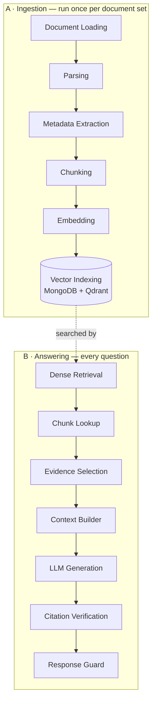
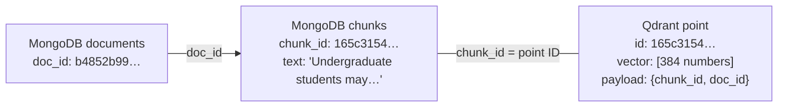
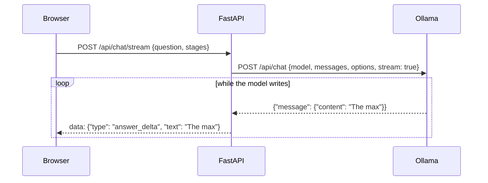
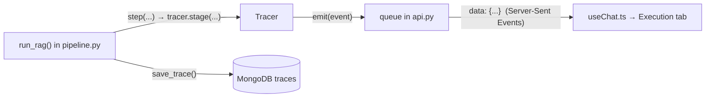

# 02 · The RAG Architecture

This document explains HYU Compass from zero: **what** each part of the pipeline does, **why**
it exists, and **where** it lives in the code. If you know basic Python you can follow it.

- Abstract classes and inheritance → [03_ABSTRACT_CLASSES.md](03_ABSTRACT_CLASSES.md)
- How methods and settings reach the UI → [04_METHOD_REGISTRY.md](04_METHOD_REGISTRY.md)

## The big picture

The pipeline is a chain of **blocks**. Each block has one job: a defined input and a defined
output. There are two chains:



The UI shows more blocks than these: query rewriting, BM25, reranking and others. They are
**registered but not implemented yet**, so they appear greyed out and the pipeline skips them.
Implementing them is your course work ([05_ADD_NEW_METHOD.md](05_ADD_NEW_METHOD.md)).

### Where the code is

```text
backend/app/
├── main.py            starts FastAPI, connects the databases
├── config.py          infrastructure settings (database URLs, model names)
├── api.py             all HTTP endpoints
├── database.py        MongoDB + Qdrant reading/writing
├── ollama.py          talks to the local Ollama server
├── tracing.py         records what each block did (for the Execution tab)
└── rag/
    ├── schemas.py     the data passed between blocks (Candidate, Evidence, …)
    ├── registry.py    THE list of blocks, methods and hyperparameters
    ├── pipeline.py    run_ingestion() and run_rag(): call the blocks in order
    └── blocks/        one file per group of blocks: abstract class + implementations
        ├── base.py             PipelineBlock (what every block has in common)
        ├── loading.py  parsing.py  chunking.py  metadata.py  embedding.py  indexing.py
        ├── query_processing.py retrieval.py  reranking.py  evidence.py
        └── generation.py       verification.py
```

---

## Part A — Ingestion (`run_ingestion()` in `backend/app/rag/pipeline.py`)

| Block | Abstract class | Working method (class) | What it does |
|---|---|---|---|
| Document Loading | `BaseDocumentLoader` | `local_folder` (`LocalFolderLoader`) | finds PDF, TXT, Markdown, HTML files; lists skipped ones |
| Parsing | `BaseDocumentParser` | `basic_parser` (`BasicDocumentParser`) | file → title + **sections** (heading, text, page) |
| Metadata Extraction | `BaseMetadataExtractor` | `basic_metadata` (`BasicMetadataExtractor`) | title, language, fields the file declares (front matter) |
| Chunking | `BaseChunker` | `section_tokens` (`SectionTokenChunker`) | sections → chunks of at most `chunk_size` tokens |
| Embedding | `BaseEmbedder` | `bge_small_en` (`SentenceTransformerEmbedder`) | text → 384-number vector |
| Vector Indexing | `BaseVectorIndexer` | `qdrant_mongodb` (`QdrantMongoIndexer`) | text → MongoDB, vectors → Qdrant |

### Why parse into sections?

Headings are natural boundaries ("Credit Limits", "How to Apply"). Keeping them lets the answer
say *where* a fact came from. For PDFs there is one section per page, so the page number is kept.

### Chunking: why not embed a whole document?

An embedding squeezes a text into 384 numbers. Squeeze a 20-page handbook into 384 numbers and
every specific fact is averaged away, and the model reads at most 512 **tokens** (words or
pieces of words). So we cut documents into **chunks** about one topic each.

`SectionTokenChunker` (in `blocks/chunking.py`):
- a section with at most `chunk_size` tokens stays **one chunk**;
- a longer section becomes windows of `chunk_size` tokens, each starting
  `chunk_size − chunk_overlap` tokens after the previous one.

```text
chunk_size = 6, chunk_overlap = 2   (step = 6 − 2 = 4)
tokens:   t1 t2 t3 t4 t5 t6 t7 t8 t9 t10
chunk 1:  t1 t2 t3 t4 t5 t6
chunk 2:              t5 t6 t7 t8 t9 t10      ← t5 t6 appear twice (the overlap)
```

| Setting | Default | Bigger | Smaller |
|---|---|---|---|
| Chunk size | 256 tokens | more context per chunk, but more mixed topics | precise matches, but a rule and its exception may separate |
| Chunk overlap | 32 tokens | sentences cut at a boundary survive; more duplicate text | less duplication |

These are **ingestion** settings. They only change after **re-indexing** (Configuration tab →
*Ingestion* → *Re-index*, or `python scripts/ingest.py --chunk-size 128 …`).

### Embeddings — text as numbers

An embedding model turns text into a vector. Texts with similar meaning point in similar
directions:

```text
"How many credits can I take?"                    → [0.012, -0.044, 0.031, …]   (384 numbers)
"Undergraduates may register for 12–18 credits"   → [0.015, -0.039, 0.027, …]   similar direction!
"Dormitory move-in checklist"                     → [-0.051, 0.008, 0.062, …]   different direction
```

The **same** model must embed documents and questions. Each model has its own "coordinate
system", so mixing them is like comparing GPS coordinates with street numbers. The dense retriever
refuses to search if the stored vectors have a different size than the question vector.

### MongoDB and Qdrant

| Database | Stores | Good at |
|---|---|---|
| **MongoDB** | `documents` (title, source, hash, metadata, how it was chunked), `chunks` (text, section, page), `traces` | readable records you can look up by ID |
| **Qdrant** | one **point** per chunk: the vector + payload `{chunk_id, doc_id}` | finding the nearest vectors among thousands, fast |

They are linked by IDs (`make_doc_id`, `make_chunk_id` in `rag/schemas.py`):



- `doc_id` comes from the file path, so the same file always gets the same ID.
- `chunk_id` comes from `doc_id` + position + text, so re-ingesting gives the same IDs.
- Both are UUIDs, which Qdrant accepts as point IDs, so the Qdrant point ID *is* the `chunk_id`.

---

## Part B — Answering a question (`run_rag()` in `backend/app/rag/pipeline.py`)

| # | Block | Abstract class | Working method | Input → Output |
|---|---|---|---|---|
| 1 | Dense Retrieval | `BaseDenseRetriever` | `qdrant_cosine` | question → `RetrievalResult` (Top K `Candidate`s with scores) |
| 2 | Chunk Lookup | `BaseMetadataEnricher` | `mongodb_lookup` | `Candidate`s → `Evidence` (with text, title, section, page) |
| 3 | Evidence Selection | `BaseEvidenceSelector` | `token_budget` | `Evidence` → the evidence that fits the token budget |
| 4 | Context Builder | `BaseContextBuilder` | `numbered_blocks` | question + `Evidence` → `PromptContext` (messages, `[E1]` labels) |
| 5 | LLM Generation | `BaseGenerator` | `ollama_chat` | `PromptContext` → `GenerationResult` (streamed answer) |
| 6 | Citation Verification | `BaseCitationVerifier` | `marker_resolution` | answer + `Evidence` → `CitationResult` |
| 7 | Response Guard | `BaseResponseGuard` | `basic_guard` | `CitationResult` (or None) → `FinalAnswer` |

### 1. Dense Retrieval and cosine similarity

`QdrantDenseRetriever` embeds the question (BGE adds a short instruction in front of questions)
and asks Qdrant for the **Top K** most similar chunk vectors.

**Cosine similarity** is the angle between two vectors:

```text
cos(q, c) = (q · c) / (|q| × |c|)        1.0 = same direction, 0.0 = unrelated
```

Our vectors have length 1, so it is simply the dot product `q · c`.

⚠️ **Similar is not the same as correct.** *"Exchange students may NOT apply"* is very similar to
*"Can exchange students apply?"*. A high score means "same topic", not "this answers it". That is
why the model reads the text and why every answer shows its sources.

**Top K** (default 5): a larger K makes it more likely the right chunk is included, but the model
also gets more unrelated text to read.

### 2. Chunk Lookup

Qdrant returned only IDs and scores. `MongoChunkLookup` loads the text, section, page and
document title from MongoDB. If an ID is in Qdrant but not in MongoDB, it stops with a clear error,
because that means the two databases are out of sync.

### 3. Evidence Selection

`TokenBudgetSelector` keeps chunks in rank order until `max_evidence_tokens` (default 2000) would
be exceeded. It always keeps at least the first chunk. This keeps prompts short for small models.

### 4. Context Builder

The evidence is written into the prompt as numbered blocks:

```text
[E1] Course Registration Handbook (Sample) — Credit Limits
Undergraduate students may register for between 12 and 18 credits per regular semester …

[E2] Course Registration Handbook (Sample) — Registration Periods
Course registration in this sample handbook has three periods. …
```

The **system prompt** (`SYSTEM_PROMPT` in `blocks/generation.py`) says: answer only from the
evidence, cite facts like `[E1]`, and reply `INSUFFICIENT_CONTEXT` if the evidence doesn't answer the
question.

### 5. LLM Generation with Ollama

**Ollama** runs the language model locally and offers a small web API on `127.0.0.1:11434`.
`app/ollama.py` uses two endpoints: `GET /api/tags` (installed models) and `POST /api/chat`
(the answer, streamed piece by piece).



Settings: **Model**, **Temperature** (randomness; it does not add knowledge) and **Max generated
tokens**. Some models like `qwen3` "think" privately first. That reasoning is removed and never
shown.

### 6. Citation Verification

`MarkerCitationVerifier` finds every `[E1]`-style marker in the answer:
- a valid marker → linked to the real chunk and document (the source card under the answer);
- a marker that matches no evidence (e.g. `[E9]` when there were 5 blocks) → **removed** and
  reported, so we never show invented sources;
- retrieved chunks the answer did not cite → shown separately as "retrieved but not cited".

This proves a citation points to **real evidence**, not that the sentence is true. *Claim
verification* would check that, and it is a planned method.

### 7. Response Guard — grounded or honest

`BasicResponseGuard` decides what the user sees:
- no evidence at all → the model is **not called**, and the answer is *"I could not find enough information…"*;
- the model replied `INSUFFICIENT_CONTEXT` → the same honest message;
- otherwise → the answer with its citations.

---

## How the Execution tab gets its data

Every block runs inside `tracer.stage(...)` (`app/tracing.py`). The tracer records the block's
**method, parameters, real input, real output and measured time**, and sends each update to the
browser as it happens:



Events on `POST /api/chat/stream`:

```text
data: {"type": "started", "request_id": "…", "config": {...the methods and parameters used...}}
data: {"type": "stage", "stage": {"stage_id": "dense_retrieval", "method_id": "qdrant_cosine", "status": "running", ...}}
data: {"type": "stage", "stage": {"stage_id": "dense_retrieval", "status": "completed", "duration_ms": 12.1, "output": {...}}}
data: {"type": "stage", "stage": {"stage_id": "reranking", "status": "skipped", "summary": "Not implemented yet."}}
data: {"type": "answer_delta", "text": "The maximum"}
data: {"type": "done", "trace": {...everything, also saved in MongoDB...}}
```

A **skipped** stage really did not run: it has no input, no output and no time. Future blocks
are shown greyed out, not as "completed". Each answer keeps its `request_id`, so clicking the
activity icon under an answer always shows that answer's own trace (from memory, or
`GET /api/traces/{request_id}`).

---

## A complete worked example (a real run)

Sample documents indexed (5 documents, 23 chunks), model `qwen3:4b`, default settings.

**Question:** *How many credits can a first-year student register for?*

| Block | Method | What happened | Time |
|---|---|---|---|
| Query Understanding … Metadata Filtering | — | skipped: not implemented yet | — |
| Dense Retrieval | `qdrant_cosine` | Top K 5; best: chunk `165c3154…`, similarity **0.8354** | 3.4 s* |
| Lexical Retrieval, Hybrid Fusion | — | skipped: not implemented yet | — |
| Chunk Lookup | `mongodb_lookup` | 5 chunk texts loaded | 3.4 ms |
| Reranking | — | skipped: not implemented yet | — |
| Evidence Selection | `token_budget` | all 5 chunks fit the 2000-token budget | <1 ms |
| Context Builder | `numbered_blocks` | 5 evidence blocks, **347 tokens** | 0.9 ms |
| LLM Generation | `ollama_chat` | 111 characters | 20.6 s |
| Citation Verification | `marker_resolution` | 1 citation resolved (`E1`) | 0.5 ms |
| Response Guard | `basic_guard` | outcome: answered | 0.1 ms |

\* The first question after starting the backend loads the embedding model. Later questions take
milliseconds here.

> **Answer:** The maximum number of credits a first-year student can register for is 18 credits
> in their first semester. **[E1]**
> **Source:** E1 · Course Registration Handbook (Sample) · Credit Limits

Almost all the time is the LLM. Timings differ on every computer.
