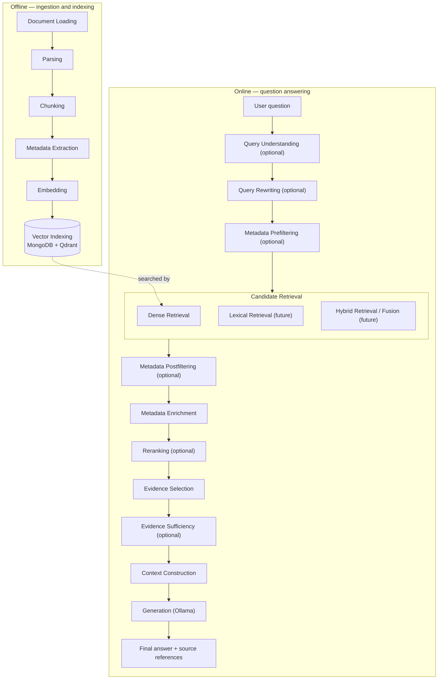
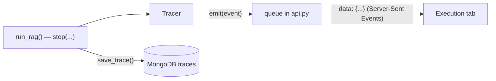

# 02 · The RAG Architecture

This document explains HYU Compass from zero, in the terms of our course *Design of Generative AI
Application Systems*: **what** each block does, **why** it exists, and **where** its code lives.

- How blocks are written (abstract classes) → [03_ABSTRACT_CLASSES.md](03_ABSTRACT_CLASSES.md)
- How methods and settings reach the UI → [04_METHOD_REGISTRY.md](04_METHOD_REGISTRY.md)

## The big picture

A RAG system has two workflows: **offline ingestion and indexing** (prepare the documents once)
and **online question answering** (every question). Each is a chain of **blocks**. A block has one
job, a defined input and a defined output.



Blocks marked *optional* or *future* are **registered but not implemented yet**. The UI shows them
greyed out, and the pipeline skips them. Implementing them is our course work
([05_ADD_NEW_METHOD.md](05_ADD_NEW_METHOD.md)).

### Where the code is

**One block = one folder, grouped by pipeline phase.** Each block folder holds the block's abstract
class in `base.py` and one file per algorithm. Related blocks live in the same **group folder**: e.g.
Dense Retrieval, Lexical Retrieval and Hybrid Fusion are all in `blocks/retrieval/`. The group folder
also decides the heading the UI shows above those blocks (`GROUPS` in `registry.py`).

```text
backend/app/
├── main.py  config.py  api.py  database.py  ollama.py  tracing.py
└── rag/
    ├── schemas.py       the data passed between blocks (Candidate, Evidence, FilterCriteria, …)
    ├── registry.py      THE list of blocks, methods and hyperparameters
    ├── pipeline.py      run_ingestion() and run_rag(): call the blocks in order
    └── blocks/
        ├── pipeline_block.py         what every block has in common (self.params, self.services)
        │
        ├── ingestion/                OFFLINE · "Ingestion"
        │   ├── document_loading/     base.py · local_loader.py ✓ · web_loader.py
        │   ├── parsing/              base.py · basic_parser.py ✓
        │   ├── chunking/             base.py · section_chunker.py ✓ · recursive_chunker.py · semantic_chunker.py
        │   ├── metadata_extraction/  base.py · basic_extractor.py ✓ · llm_extractor.py
        │   ├── embedding/            base.py · bge_embedder.py ✓ · ollama_embedder.py
        │   └── vector_indexing/      base.py · qdrant_indexer.py ✓
        │
        ├── query_processing/         ONLINE · "Query Processing"
        │   ├── query_understanding/  base.py · llm_understanding.py
        │   └── query_rewriting/      base.py · llm_rewriter.py · multi_query.py
        │
        ├── metadata_filtering/       ONLINE · "Metadata Filtering"
        │   ├── metadata_prefiltering/   base.py · qdrant_prefilter.py       (runs BEFORE retrieval)
        │   └── metadata_postfiltering/  base.py · candidate_postfilter.py   (runs AFTER retrieval)
        │
        ├── retrieval/                ONLINE · "Candidate Retrieval"
        │   ├── dense_retrieval/      base.py · qdrant_cosine.py ✓
        │   ├── lexical_retrieval/    base.py · bm25.py
        │   └── hybrid_fusion/        base.py · rrf.py
        │
        ├── evidence/                 ONLINE · "Evidence"
        │   ├── metadata_enrichment/  base.py · mongodb_enrichment.py ✓
        │   ├── reranking/            base.py · cross_encoder.py · metadata_reranker.py
        │   ├── evidence_selection/   base.py · token_budget_selector.py ✓
        │   └── evidence_sufficiency/ base.py · sufficiency_checker.py
        │
        └── grounded_generation/      ONLINE · "Grounded Generation"
            ├── context_construction/ base.py · standard_context.py ✓
            └── generation/           base.py · ollama_generator.py ✓
```

The folders show **where code lives**; `run_rag()` decides **when it runs**. The two metadata
filtering blocks share a folder because they solve the same problem, but prefiltering runs before
retrieval and postfiltering after it.

✓ = implemented (the working basic RAG). Every other algorithm file is a **teaching skeleton** with
TODO steps that raises `NotImplementedError`.

---

## Part A — Offline: ingestion and indexing (`run_ingestion()` in `rag/pipeline.py`)

| Block (folder) | Working method | What it does |
|---|---|---|
| Document Loading (`ingestion/document_loading/`) | `local_loader.py` · `LocalFolderLoader` | finds PDF, TXT, Markdown, HTML files; lists skipped ones |
| Parsing (`ingestion/parsing/`) | `basic_parser.py` · `BasicDocumentParser` | file → title + **sections** (heading, text, page) |
| Chunking (`ingestion/chunking/`) | `section_chunker.py` · `SectionTokenChunker` | sections → chunks of at most `chunk_size` tokens |
| Metadata Extraction (`ingestion/metadata_extraction/`) | `basic_extractor.py` · `BasicMetadataExtractor` | title, language, fields the file declares (front matter) |
| Embedding (`ingestion/embedding/`) | `bge_embedder.py` · `SentenceTransformerEmbedder` | text → 384-number vector (BAAI/bge-small-en-v1.5) |
| Vector Indexing (`ingestion/vector_indexing/`) | `qdrant_indexer.py` · `QdrantMongoIndexer` | text → MongoDB, vectors → Qdrant |

**Parsing** splits at headings ("Credit Limits", "How to Apply"), so an answer can say *where* a
fact came from. PDFs get one section per page, so the page number is kept.

**Chunking.** An embedding squeezes a text into 384 numbers. Squeeze a 20-page handbook into one
vector and every specific fact is averaged away, and the model reads at most 512 **tokens** anyway.
So documents become **chunks**: a section with at most `chunk_size` tokens stays one chunk, and a
longer one becomes windows that overlap by `chunk_overlap` tokens:

```text
chunk_size = 6, chunk_overlap = 2   (each window starts 6 − 2 = 4 tokens after the previous one)
tokens:   t1 t2 t3 t4 t5 t6 t7 t8 t9 t10
chunk 1:  t1 t2 t3 t4 t5 t6
chunk 2:              t5 t6 t7 t8 t9 t10      ← t5 t6 appear twice (the overlap)
```

Chunk size and overlap are **ingestion** settings: they only change after **re-indexing**
(Configuration tab → Ingestion → *Re-index*, or `python scripts/ingest.py --chunk-size 128 …`).

**Embedding.** Texts with similar meaning get vectors pointing in similar directions. The **same**
model must embed documents and questions, because each model has its own "coordinate system".
Dense retrieval refuses to search if the stored vector size doesn't match.

**Vector Indexing — MongoDB and Qdrant.** MongoDB stores readable records (`documents`, `chunks`
with their text, `traces`). Qdrant stores one **point** per chunk: the vector plus the payload
`{chunk_id, doc_id}`. They are linked by IDs: the Qdrant point ID *is* the `chunk_id`, which comes
from `doc_id` + position + text (`make_chunk_id` in `rag/schemas.py`). So re-ingesting the same
files gives the same IDs.

---

## Part B — Online: question answering (`run_rag()` in `rag/pipeline.py`)

| # | Block (folder) | Status | Input → Output |
|---|---|---|---|
| 1 | Query Understanding (`query_processing/query_understanding/`) | planned | question → `QueryAnalysis` (intent, `FilterCriteria`) |
| 2 | Query Rewriting (`query_processing/query_rewriting/`) | planned | question → `RewrittenQuery` |
| 3 | **Metadata Prefiltering** (`metadata_filtering/metadata_prefiltering/`) | planned | `FilterCriteria` → `RetrievalFilter` (a predicate) |
| 4 | Dense Retrieval (`retrieval/dense_retrieval/`) | **working** | query + predicate → `RetrievalResult` (Top K `Candidate`s) |
| 5 | Lexical Retrieval (`retrieval/lexical_retrieval/`) | planned | query + predicate → `RetrievalResult` |
| 6 | Hybrid Retrieval / Fusion (`retrieval/hybrid_fusion/`) | planned | two `RetrievalResult`s → one |
| 7 | **Metadata Postfiltering** (`metadata_filtering/metadata_postfiltering/`) | planned | `Candidate`s + `FilterCriteria` → `PostfilterResult` |
| 8 | Metadata Enrichment (`evidence/metadata_enrichment/`) | **working** | `Candidate`s → `Evidence` (text, title, section, page) |
| 9 | Reranking (`evidence/reranking/`) | planned | `Evidence` → reordered `Evidence` |
| 10 | Evidence Selection (`evidence/evidence_selection/`) | **working** | `Evidence` → the evidence that fits the token budget |
| 11 | Evidence Sufficiency (`evidence/evidence_sufficiency/`) | planned | `Evidence` → `SufficiencyDecision` |
| 12 | Context Construction (`grounded_generation/context_construction/`) | **working** | question + `Evidence` → `PromptContext` (`[E1]` labels) |
| 13 | Generation (`grounded_generation/generation/`) | **working** | `PromptContext` → `GenerationResult` (streamed) |

Steps 4–6 together are **Candidate Retrieval**. The UI groups them under that name.

### Candidate retrieval: dense, lexical, hybrid

**Dense Retrieval** (`QdrantDenseRetriever`) embeds the question and asks Qdrant for the Top K
chunk vectors with the highest **cosine similarity**:

```text
cos(q, c) = (q · c) / (|q| × |c|)        1.0 = same direction, 0.0 = unrelated
```

Our vectors have length 1, so this is simply the dot product.

**Lexical Retrieval** (future: BM25) ranks chunks by shared *words*. It is strong for exact terms
like "TOPIK" or "add/drop", where meaning-based search can be vague. **Hybrid Retrieval** merges
both candidate lists, e.g. with Reciprocal Rank Fusion: `score = Σ 1/(k + rank)`.

**Top K** (default 5): a larger K makes it more likely the right chunk is a candidate, but the model
also gets more unrelated text.

### Metadata filtering: Prefiltering and Postfiltering

Some documents only apply to some students, e.g. an ERICA dormitory notice. **Metadata filtering**
enforces such *eligibility* conditions. There are two placements, and they behave differently:

**Prefiltering** applies the eligibility conditions *during* candidate retrieval: the retriever
searches **only within the eligible subset**. The block `metadata_filtering/metadata_prefiltering/` builds a
predicate (`RetrievalFilter`, e.g. `{"campus": ["ERICA", "ALL"]}`). The runner passes it **into**
the retrievers, and `QdrantDenseRetriever` turns it into a Qdrant `query_filter`, so Qdrant ranks only
eligible chunks.

**Postfiltering** first retrieves a limited candidate list, then removes ineligible candidates
(`metadata_filtering/metadata_postfiltering/`). It works only on what was already retrieved.

```text
PREFILTERING                                   POSTFILTERING
eligible subset ──► search ──► Top 5           all chunks ──► search ──► Top 5 ──► remove ineligible ──► 0–5 left
(always up to 5 eligible results)              (eligible chunks ranked 6th or lower are never seen)
```

**Candidate starvation.** Postfiltering cannot recover relevant documents that were excluded from
the initial candidate pool.

*Synthetic example, in the style of the lecture's laptop-loan case:* an ERICA student asks *"Can I
borrow a laptop?"*. The Top 5 candidates are all Seoul library rules, because there are more of
them and they use the same words. The ERICA rule is ranked 7th. Postfiltering removes all five
Seoul chunks and leaves **nothing**, although the right answer exists. With prefiltering, the
search runs only over ERICA and university-wide chunks, so the ERICA rule ranks first.

If postfiltering leaves no candidates, the system must abstain. It must **not** quietly drop the
student's conditions to fill the list.

| Prefiltering | Postfiltering | Meaning |
|---|---|---|
| Off | Off | Baseline retrieval (today) |
| On | Off | Search only eligible sources |
| Off | On | Filter the retrieved candidates afterwards |
| On | On | Retrieval-time eligibility, plus an extra check afterwards |

Both blocks read the **same** `FilterCriteria` (from Query Understanding), so they cannot
contradict each other. The criteria only come from what the question or student actually states;
the system never invents user attributes. Both blocks are planned and disabled for now.

### Metadata Enrichment, Reranking, Evidence Selection

**Metadata Enrichment** (`MongoChunkLookup`): Qdrant returned only IDs and scores, so the text,
section, page and document title are loaded from MongoDB. A chunk in Qdrant that is missing in
MongoDB is an error: re-index.

**Reranking** (future, e.g. a cross-encoder that reads question and chunk *together*) puts the most
relevant evidence first.

**Evidence Selection** (`TokenBudgetSelector`) keeps chunks in rank order until
`max_evidence_tokens` (default 2000) would be exceeded, which keeps prompts short for small models.

### Evidence Sufficiency and Abstention

**Evidence Sufficiency** (future) asks: is this evidence good enough to answer at all? If not, the
system **abstains**: it does not call the model and answers *"I could not find enough information…"*.
The basic system already abstains in two cases:
- no evidence was retrieved → the model is not called;
- the model replies `INSUFFICIENT_CONTEXT` (the prompt tells it to when the evidence is missing).

### Context Construction and Grounded Generation

**Context Construction** (`StandardContextBuilder`) writes the evidence into the prompt as numbered
blocks, together with the grounding rules (`SYSTEM_PROMPT` in
`grounded_generation/context_construction/standard_context.py`):

```text
[E1] Course Registration Handbook (Sample) — Credit Limits
Undergraduate students may register for between 12 and 18 credits per regular semester …

[E2] Course Registration Handbook (Sample) — Registration Periods
Course registration in this sample handbook has three periods. …
```

**Grounded generation** (`OllamaGenerator`): the local Ollama model answers **only from the
evidence**, writes the label of each block it uses (like `[E1]`), and streams its answer to the
browser. `app/ollama.py` uses `GET /api/tags` (installed models) and `POST /api/chat`. Settings:
model, temperature (randomness, not knowledge) and max generated tokens. Hidden "thinking" of models
like `qwen3` is removed and never shown.

### Source references (source attribution)

After generation, `attach_sources()` in `rag/pipeline.py` turns each evidence block into a
**source reference**: document title, section, page, chunk ID and an excerpt. A reference is marked
*cited* if the answer contains its `[E#]` label. Labels that match no evidence block are removed,
so the UI never shows a source that doesn't exist.

This is **attribution**: it tells you which retrieved text the answer points to. It does **not**
verify that each sentence is true, and the project has no claim-verification stage. It is also
**not Postfiltering**. Postfiltering removes *ineligible candidates before generation*; resolving
`[E#]` labels happens *after generation* and only links the answer to the evidence it was given.

### Four different questions

| Concept | Question | Where it is decided |
|---|---|---|
| **Relevance** | Does this chunk match the question? | candidate retrieval scores, reranking |
| **Eligibility** | Does this document apply to this student (campus, audience, year)? | metadata prefiltering / postfiltering |
| **Evidence sufficiency** | Is the selected evidence enough to answer? | evidence sufficiency (+ abstention) |
| **Source attribution** | Which retrieved text does the answer point to? | `[E#]` labels → source references |

⚠️ A highly *relevant* chunk can be *ineligible* (wrong campus). An eligible, relevant chunk can
still be *insufficient*. A well-*attributed* sentence can still be wrong. Keep these apart in
reports and experiments.

---

## How the Execution tab gets its data

Every block runs inside `tracer.stage(...)` (`app/tracing.py`). The tracer records the block's
**method, parameters, real input, real output and measured time**, and streams each update to the
browser:



```text
data: {"type": "started", "request_id": "…", "config": {...the methods and parameters used...}}
data: {"type": "stage", "stage": {"stage_id": "dense_retrieval", "method_id": "qdrant_cosine", "status": "completed",
                                  "input": {"query": "…", "prefilter": null}, "output": {"candidates": [...]}, "duration_ms": 12.1}}
data: {"type": "stage", "stage": {"stage_id": "metadata_postfiltering", "status": "skipped", "summary": "Not implemented yet."}}
data: {"type": "answer_delta", "text": "The maximum"}
data: {"type": "done", "trace": {...answer, outcome, sources, every stage — also saved in MongoDB...}}
```

A **skipped** stage really did not run: no input, no output, no time. Each answer keeps its
`request_id`, so the activity icon under an answer always opens *that* answer's trace.

---

## A complete worked example (a real run)

Sample documents indexed (5 documents, 23 chunks), model `qwen3:4b`, default settings.

**Question:** *How many credits can a first-year student register for?*

| Block | Method | What happened |
|---|---|---|
| Query Understanding, Query Rewriting, Metadata Prefiltering | — | skipped: not implemented yet |
| Dense Retrieval | `qdrant_cosine` | Top K 5, no prefilter; best: chunk `165c3154…`, similarity **0.8354** |
| Lexical Retrieval, Hybrid Fusion, Metadata Postfiltering | — | skipped: not implemented yet |
| Metadata Enrichment | `mongodb_lookup` | 5 chunk texts loaded from MongoDB |
| Reranking | — | skipped |
| Evidence Selection | `token_budget` | all 5 chunks fit the 2000-token budget |
| Evidence Sufficiency | — | skipped |
| Context Construction | `standard_context` | 5 evidence blocks, **347 tokens** |
| Generation | `ollama_chat` | streamed answer |

> **Answer:** The maximum number of credits a first-year student can register for is 18 credits
> in their first semester. **[E1]**
> **Source:** E1 · Course Registration Handbook (Sample) · Credit Limits

Almost all the time is spent in generation. The first question after starting the backend also
loads the embedding model (a few seconds). Timings differ on every computer.
