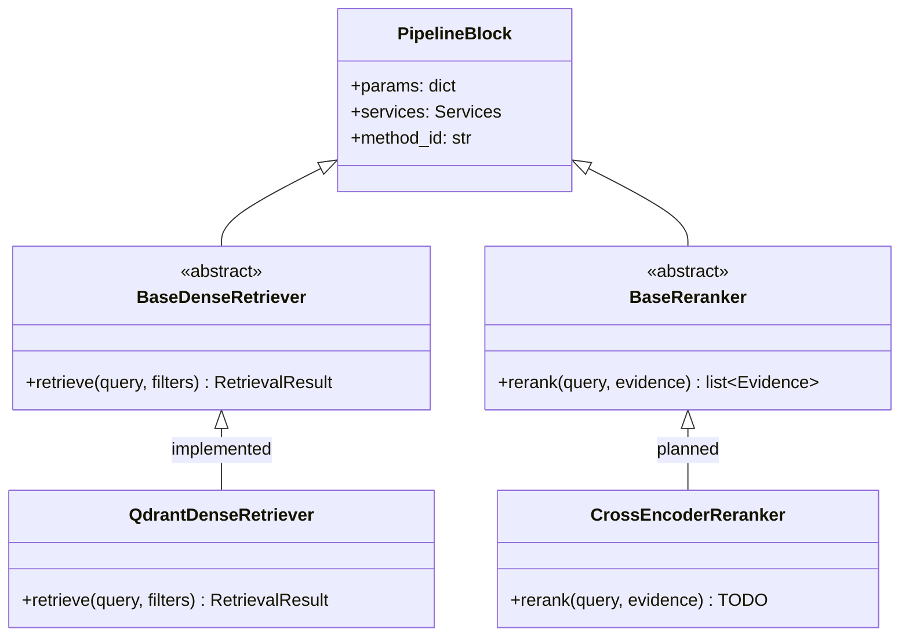

# 03 · Abstract Classes: How Every Block Is Built

Every block of the RAG pipeline (chunking, dense retrieval, reranking, …) is described by an
**abstract class**. Every algorithm for that block is a **subclass** of it. This document
explains what that means from the very beginning, using the project's real code.

## 1. Classes and inheritance — a 2-minute refresher

A **class** is a blueprint for objects. **Inheritance** means "class B is a kind of class A":
B gets everything A has and can add or replace parts.

```python
class Animal:
    def describe(self) -> str:
        return f"I am {self.name}"


class Dog(Animal):          # Dog inherits from Animal
    name = "a dog"

    def speak(self) -> str:
        return "Woof"


rex = Dog()
rex.describe()   # 'I am a dog'  ← inherited from Animal
rex.speak()      # 'Woof'        ← Dog's own method
```

## 2. What is an abstract class?

Sometimes the parent class should only say **what** every child must be able to do, not **how**.
Think of a job description: "every retriever must be able to retrieve chunks for a query". It
doesn't say how, because that is up to each retriever.

Python's `abc` module ("Abstract Base Classes") does this:

```python
from abc import ABC, abstractmethod


class Shape(ABC):                       # ABC = "this class is abstract"
    @abstractmethod
    def area(self) -> float:            # every subclass MUST write this method
        """Return the area."""


class Square(Shape):
    def __init__(self, side: float) -> None:
        self.side = side

    def area(self) -> float:            # the promise is kept
        return self.side * self.side
```

Two rules follow:

1. **You cannot create an object of the abstract class itself.** `Shape()` raises a `TypeError`,
   because a "shape in general" has no area formula.
2. **A subclass must implement every `@abstractmethod`**, or creating it also raises `TypeError`.
   Python checks this the moment you create the object, so a forgotten method is found
   immediately, not in the middle of a request.

| Term | Meaning |
|---|---|
| `ABC` | base class that makes a class abstract |
| `@abstractmethod` | "subclasses must implement this method" |
| interface | the set of methods (names, inputs, outputs) a class promises to have |
| concrete class | a subclass that implements everything, so objects can be created |

## 3. Why every pipeline block has an interface

The pipeline runner only knows the **interface**. It calls `retriever.retrieve(query)`, whichever
retriever that is. So you can swap in a new retriever without touching the runner, the API or the
UI. You only write a subclass and register it.



There are only **two levels** above every implementation:

1. `PipelineBlock` (`backend/app/rag/blocks/base.py`) — what *every* block has:
   ```python
   class PipelineBlock(ABC):
       def __init__(self, params: dict[str, Any], services: Services) -> None:
           self.params = params          # its hyperparameters, already validated by the registry
           self.services = services      # shared tools: .db, .embedder, .ollama, .settings
           self.method_id = ""           # set by the registry when it creates the block
   ```
2. A **block-specific** abstract class with one required method and typed input/output. For
   example, in `backend/app/rag/blocks/retrieval.py`:
   ```python
   class BaseDenseRetriever(PipelineBlock):
       """Find chunks whose *meaning* is close to the query.

       Input:  query text, optional metadata filter {field: allowed values}
       Output: RetrievalResult with Candidates (rank, chunk_id, doc_id, score), best first.
       Hyperparameters such as top_k are in self.params.
       """

       @abstractmethod
       async def retrieve(self, query: str, filters: dict[str, list[str]] | None = None) -> RetrievalResult: ...
   ```

### Implementing the interface — the real dense retriever

```python
class QdrantDenseRetriever(BaseDenseRetriever):
    """IMPLEMENTED — embed the query, then ask Qdrant for the `top_k` nearest chunk vectors (cosine)."""

    async def retrieve(self, query, filters=None) -> RetrievalResult:
        db, embedder = self.services.db, self.services.embedder        # shared tools
        vector = embedder.embed_query(query)
        points = db.search(vector, self.params["top_k"], qdrant_filter)   # hyperparameter from the registry
        candidates = [Candidate(rank=i + 1, chunk_id=str(p.id), doc_id=p.payload["doc_id"], score=round(float(p.score), 4))
                      for i, p in enumerate(points)]
        return RetrievalResult(candidates=candidates, details={...})
```

(shortened; the full version also checks the vector size and builds the Qdrant filter.)

Notice three habits that every block follows:
- **Hyperparameters** come from `self.params` (here `self.params["top_k"]`). Never hard-code them.
- **Shared tools** come from `self.services` (`db`, `embedder`, `ollama`, `settings`).
- **Inputs and outputs are typed dataclasses** from `backend/app/rag/schemas.py`
  (`Candidate`, `RetrievalResult`, `Evidence`, …), not loose dictionaries. Your editor can
  autocomplete them, and the next block knows exactly what it receives.

Online blocks use `async def` (they may wait for databases or Ollama). Offline blocks are normal
`def`. Copy what the abstract method uses.

### A planned method — a skeleton

Future methods already exist as **skeleton** subclasses with TODO steps, e.g. in
`backend/app/rag/blocks/reranking.py`:

```python
class CrossEncoderReranker(BaseReranker):
    """PLANNED — a model that reads question and chunk *together* scores each pair."""

    async def rerank(self, query: str, evidence: list[Evidence]) -> list[Evidence]:
        # TODO:
        # 1. Load a cross-encoder: sentence_transformers.CrossEncoder("cross-encoder/ms-marco-MiniLM-L-6-v2").
        # 2. Score each pair: model.predict([(query, e.text) for e in evidence]).
        # 3. Sort evidence by score (highest first), keep self.params["top_n"], renumber rank.
        raise NotImplementedError("Cross-encoder reranking is not implemented yet.")
```

A skeleton is **not** a working method. It is registered with `implemented=False`, the registry
refuses to create it, and the UI shows it greyed out. When you implement it, you replace the
`raise` with real code and flip the flag ([05_ADD_NEW_METHOD.md](05_ADD_NEW_METHOD.md)).

## 4. All 21 blocks

| Phase | Block (stage ID) | Abstract class | Required method | Input → Output | File in `rag/blocks/` |
|---|---|---|---|---|---|
| offline | Document Loading (`document_loading`) | `BaseDocumentLoader` | `load(folder)` | folder → (files, skipped) | `loading.py` |
| offline | Parsing (`parsing`) | `BaseDocumentParser` | `parse(path)` | file → `ParsedDocument` | `parsing.py` |
| offline | Chunking (`chunking`) | `BaseChunker` | `chunk(document)` | `ParsedDocument` → `list[Chunk]` | `chunking.py` |
| offline | Metadata Extraction (`metadata_extraction`) | `BaseMetadataExtractor` | `extract(document)` | `ParsedDocument` → `DocumentMetadata` | `metadata.py` |
| offline | Embedding (`embedding`) | `BaseEmbedder` | `embed_documents`, `embed_query`, `dimension`, `token_offsets` | texts → vectors | `embedding.py` |
| offline | Vector Indexing (`vector_indexing`) | `BaseVectorIndexer` | `index(...)` | records + vectors → stored | `indexing.py` |
| online | Query Understanding (`query_understanding`) | `BaseQueryUnderstanding` | `analyze(question)` | question → `QueryAnalysis` | `query_processing.py` |
| online | Query Rewriting (`query_rewriting`) | `BaseQueryRewriter` | `rewrite(question)` | question → search query | `query_processing.py` |
| online | Constraint Validation (`constraint_validation`) | `BaseConstraintValidator` | `validate(analysis)` | `QueryAnalysis` → constraints | `query_processing.py` |
| online | Metadata Filtering (`metadata_filtering`) | `BaseMetadataFilter` | `build_filter(constraints)` | constraints → filter | `query_processing.py` |
| online | Dense Retrieval (`dense_retrieval`) | `BaseDenseRetriever` | `retrieve(query, filters)` | query → `RetrievalResult` | `retrieval.py` |
| online | Lexical Retrieval (`lexical_retrieval`) | `BaseLexicalRetriever` | `retrieve(query, filters)` | query → `RetrievalResult` | `retrieval.py` |
| online | Hybrid Fusion (`hybrid_fusion`) | `BaseHybridFusion` | `fuse(dense, lexical)` | two candidate lists → `RetrievalResult` | `retrieval.py` |
| online | Chunk Lookup (`metadata_enrichment`) | `BaseMetadataEnricher` | `enrich(candidates)` | `Candidate`s → `Evidence` | `retrieval.py` |
| online | Reranking (`reranking`) | `BaseReranker` | `rerank(query, evidence)` | `Evidence` → reordered `Evidence` | `reranking.py` |
| online | Evidence Selection (`evidence_selection`) | `BaseEvidenceSelector` | `select(evidence)` | `Evidence` → fewer `Evidence` | `evidence.py` |
| online | Evidence Sufficiency (`sufficiency_gate`) | `BaseSufficiencyGate` | `check(question, evidence)` | → `SufficiencyDecision` | `evidence.py` |
| online | Context Builder (`context_builder`) | `BaseContextBuilder` | `build(question, evidence)` | → `PromptContext` | `generation.py` |
| online | LLM Generation (`generation`) | `BaseGenerator` | `generate(prompt, on_token)` | `PromptContext` → `GenerationResult` | `generation.py` |
| online | Citation Verification (`citation_verification`) | `BaseCitationVerifier` | `verify(answer, evidence)` | → `CitationResult` | `verification.py` |
| online | Response Guard (`response_guard`) | `BaseResponseGuard` | `finalize(result)` | `CitationResult` or None → `FinalAnswer` | `verification.py` |

Working methods today: `LocalFolderLoader`, `BasicDocumentParser`, `SectionTokenChunker`,
`BasicMetadataExtractor`, `SentenceTransformerEmbedder`, `QdrantMongoIndexer`,
`QdrantDenseRetriever`, `MongoChunkLookup`, `TokenBudgetSelector`, `NumberedContextBuilder`,
`OllamaGenerator`, `MarkerCitationVerifier`, `BasicResponseGuard`. Everything else is a skeleton.

## 5. The errors you will see (and what they mean)

These are the **exact** messages from the real classes.

**Creating the abstract class itself:**
```text
>>> BaseReranker({}, services)
TypeError: Can't instantiate abstract class BaseReranker without an implementation for abstract method 'rerank'
```
→ Create your subclass instead, not the `Base…` class.

**Forgetting the method, or misspelling its name:**
```python
class MyReranker(BaseReranker):
    async def re_rank(self, query, evidence):      # typo: must be "rerank"
        ...
```
```text
TypeError: Can't instantiate abstract class MyReranker without an implementation for abstract method 'rerank'
```
→ Copy the method name and signature exactly from the abstract class. The app also checks every
registered class when it starts (`check_registry()` in `registry.py`), so this error shows up
immediately when you start the backend.

**Running a skeleton directly:**
```text
NotImplementedError: Cross-encoder reranking is not implemented yet.
```
**Asking the registry for a planned method:**
```text
NotImplementedError: 'Cross-encoder' (reranking) is registered as not implemented and cannot run
```
→ Both mean the method is not finished, or not yet marked `implemented=True`.

**Returning the wrong type** (e.g. a plain list instead of `RetrievalResult`): Python does not
stop this automatically, but the next block will fail with an `AttributeError` such as
`'list' object has no attribute 'candidates'`. The Execution tab shows it on the failing stage.
Always return the type the abstract method promises, and test it
([05_ADD_NEW_METHOD.md](05_ADD_NEW_METHOD.md#step-6--add-a-test)).

The backend tests check these rules: `backend/tests/test_blocks.py` (abstract classes cannot be
created, missing methods fail) and `backend/tests/test_registry.py` (every registered class
inherits from the right abstract class).
