# 03 · Abstract Classes: How Every Block Is Built

Every block of the RAG pipeline (chunking, dense retrieval, reranking, …) is a **folder**. Inside it,
`base.py` describes the block with an **abstract class**, and every algorithm for the block is a
**subclass** in its own file. This document explains what that means from the very beginning,
using the project's real code.

## 1. Classes and inheritance — a 2-minute refresher

A **class** is a blueprint for objects. **Inheritance** means "class B is a kind of class A": B
gets everything A has and can add or replace parts.

```python
class Animal:
    def describe(self) -> str:
        return f"I am {self.name}"


class Dog(Animal):          # Dog inherits from Animal
    name = "a dog"


Dog().describe()            # 'I am a dog'  ← inherited from Animal
```

## 2. What is an abstract class?

Sometimes the parent class should only say **what** every child must be able to do, not **how**,
like a job description: "every retriever must be able to retrieve candidates for a query".
Python's `abc` module ("Abstract Base Classes") does this:

```python
from abc import ABC, abstractmethod


class Shape(ABC):                       # ABC = "this class is abstract"
    @abstractmethod
    def area(self) -> float:            # every subclass MUST write this method
        """Return the area."""


class Square(Shape):
    def __init__(self, side: float) -> None:
        self.side = side

    def area(self) -> float:            # the promise is kept
        return self.side * self.side
```

Two rules follow:

1. **You cannot create an object of the abstract class itself.** `Shape()` raises `TypeError`.
2. **A subclass must implement every `@abstractmethod`**, or creating it also raises `TypeError`.
   Python checks this when the object is created, so a forgotten method is found immediately.

| Term | Meaning |
|---|---|
| `ABC` | base class that makes a class abstract |
| `@abstractmethod` | "subclasses must implement this method" |
| interface | the methods (names, inputs, outputs) a class promises to have |
| concrete class | a subclass that implements everything, so objects can be created |

## 3. Polymorphism and method replacement

**Polymorphism** means: code that works with the abstract type works with *every* subclass.

```python
shapes: list[Shape] = [Square(2), Circle(1)]
total = sum(s.area() for s in shapes)    # each object uses its own area()
```

Our pipeline runner works the same way. It only knows the abstract method:

```python
dense = await step("dense_retrieval", lambda b: b.retrieve(query, prefilter), {...})
```

`b` can be `QdrantDenseRetriever` or any future dense retriever: the runner never changes. To
**replace a method**, you write another subclass and select it in the UI. The runner, the API and
the React code stay as they are.

## 4. How one block folder looks

Take Dense Retrieval, `backend/app/rag/blocks/retrieval/dense_retrieval/`:

```text
retrieval/dense_retrieval/
├── __init__.py          a one-line description of the block
├── base.py              the abstract class BaseDenseRetriever  (READ THIS FIRST)
└── qdrant_cosine.py     QdrantDenseRetriever(BaseDenseRetriever)  — the working method
```

`base.py`:

```python
class BaseDenseRetriever(PipelineBlock):
    """Find chunks whose *meaning* is close to the query.

    Input:  query text; optional RetrievalFilter from metadata prefiltering, which MUST be applied
            during the search (only eligible chunks may be ranked)
    Output: RetrievalResult with Candidates (rank, chunk_id, doc_id, score), best first, and the
            filter that was really applied. Hyperparameters such as top_k are in self.params.
    """

    @abstractmethod
    async def retrieve(self, query: str, prefilter: RetrievalFilter | None = None) -> RetrievalResult: ...
```

`qdrant_cosine.py` (shortened):

```python
class QdrantDenseRetriever(BaseDenseRetriever):
    async def retrieve(self, query: str, prefilter: RetrievalFilter | None = None) -> RetrievalResult:
        db, embedder = self.services.db, self.services.embedder         # shared tools
        vector = embedder.embed_query(query)
        qdrant_filter = to_qdrant_filter(prefilter) if prefilter else None  # prefilter goes INTO the search
        points = db.search(vector, self.params["top_k"], qdrant_filter)    # hyperparameter from the registry
        candidates = [Candidate(rank=i + 1, chunk_id=str(p.id), doc_id=p.payload["doc_id"], score=round(float(p.score), 4))
                      for i, p in enumerate(points)]
        return RetrievalResult(candidates=candidates, applied_filter=prefilter, details={...})
```

### The two levels above every algorithm

```mermaid
classDiagram
    class PipelineBlock {
        <<abstract>>
        +params: dict
        +services: Services
        +method_id: str
    }
    class BaseDenseRetriever {
        <<abstract>>
        +retrieve(query, prefilter) RetrievalResult
    }
    class QdrantDenseRetriever {
        +retrieve(query, prefilter) RetrievalResult
    }
    class BaseMetadataPrefilter {
        <<abstract>>
        +build_filter(criteria) RetrievalFilter
    }
    class QdrantMetadataPrefilter {
        +build_filter(criteria)  TODO
    }
    PipelineBlock <|-- BaseDenseRetriever
    PipelineBlock <|-- BaseMetadataPrefilter
    BaseDenseRetriever <|-- QdrantDenseRetriever : implemented
    BaseMetadataPrefilter <|-- QdrantMetadataPrefilter : planned
```



1. `PipelineBlock` (`blocks/pipeline_block.py`) gives every block the same three attributes:
   ```python
   class PipelineBlock(ABC):
       def __init__(self, params: dict[str, Any], services: Services) -> None:
           self.params = params          # its hyperparameters, already validated by the registry
           self.services = services      # shared tools: .db, .embedder, .ollama, .settings
           self.method_id = ""           # set by the registry when it creates the block
   ```
2. The block's own `base.py` adds **one required method** with typed input and output.

Habits every algorithm follows:
- **Hyperparameters** come from `self.params` (e.g. `self.params["top_k"]`). Never hard-code them.
- **Shared tools** come from `self.services` (`db`, `embedder`, `ollama`, `settings`).
- **Inputs and outputs are Pydantic models** from `rag/schemas.py` (`Candidate`,
  `RetrievalResult`, `Evidence`, `FilterCriteria`, …), not loose dictionaries. Create them with
  keywords: `Candidate(rank=1, chunk_id="…", doc_id="…", score=0.8)`. A wrong type or a missing
  field raises an error immediately.
- Online blocks use `async def` (they may wait for databases or Ollama); offline blocks use `def`.
  Copy what `base.py` uses.

### Planned methods are skeletons

Example: `metadata_filtering/metadata_postfiltering/candidate_postfilter.py`:

```python
class CandidateMetadataPostfilter(BaseMetadataPostfilter):
    async def filter_candidates(self, candidates: list[Candidate], criteria: FilterCriteria) -> PostfilterResult:
        # TODO:
        # 1. If criteria.conditions() is empty, keep every candidate.
        # 2. Load each candidate's document: self.services.db.get_documents([c.doc_id for c in candidates]).
        # 3. Compare document["metadata"] with each condition ...
        # 4. Return PostfilterResult(kept=[...], removed=[RemovedCandidate(chunk_id=..., reason=...)]).
        raise NotImplementedError("Metadata postfiltering is not implemented yet.")
```

A skeleton is **not** a working method. It is registered with `implemented=False`, the registry
refuses to create it, and the UI shows it greyed out. To implement it, replace the `raise` with real
code, test it, and flip the flag ([05_ADD_NEW_METHOD.md](05_ADD_NEW_METHOD.md)).

## 5. All 19 blocks

| Phase | Folder (`app/rag/blocks/…`) | Abstract class (`base.py`) | Required method | Input → Output | Algorithms (✓ = working) |
|---|---|---|---|---|---|
| offline | `ingestion/document_loading/` | `BaseDocumentLoader` | `load(folder)` | folder → (files, skipped) | `local_loader` ✓, `web_loader` |
| offline | `ingestion/parsing/` | `BaseDocumentParser` | `parse(path)` | file → `ParsedDocument` | `basic_parser` ✓ |
| offline | `ingestion/chunking/` | `BaseChunker` | `chunk(document)` | `ParsedDocument` → `list[Chunk]` | `section_chunker` ✓, `recursive_chunker`, `semantic_chunker` |
| offline | `ingestion/metadata_extraction/` | `BaseMetadataExtractor` | `extract(document)` | → `DocumentMetadata` | `basic_extractor` ✓, `llm_extractor` |
| offline | `ingestion/embedding/` | `BaseEmbedder` | `embed_documents`, `embed_query`, `dimension`, `token_offsets` | texts → vectors | `bge_embedder` ✓, `ollama_embedder` |
| offline | `ingestion/vector_indexing/` | `BaseVectorIndexer` | `index(...)` | records + vectors → stored | `qdrant_indexer` ✓ |
| online | `query_processing/query_understanding/` | `BaseQueryUnderstanding` | `analyze(question)` | → `QueryAnalysis` | `llm_understanding` |
| online | `query_processing/query_rewriting/` | `BaseQueryRewriter` | `rewrite(question)` | → `RewrittenQuery` | `llm_rewriter`, `multi_query` |
| online | `metadata_filtering/metadata_prefiltering/` | `BaseMetadataPrefilter` | `build_filter(criteria)` | `FilterCriteria` → `RetrievalFilter` | `qdrant_prefilter` |
| online | `retrieval/dense_retrieval/` | `BaseDenseRetriever` | `retrieve(query, prefilter)` | → `RetrievalResult` | `qdrant_cosine` ✓ |
| online | `retrieval/lexical_retrieval/` | `BaseLexicalRetriever` | `retrieve(query, prefilter)` | → `RetrievalResult` | `bm25` |
| online | `retrieval/hybrid_fusion/` | `BaseHybridFusion` | `fuse(dense, lexical)` | 2 × `RetrievalResult` → 1 | `rrf` |
| online | `metadata_filtering/metadata_postfiltering/` | `BaseMetadataPostfilter` | `filter_candidates(candidates, criteria)` | → `PostfilterResult` | `candidate_postfilter` |
| online | `evidence/metadata_enrichment/` | `BaseMetadataEnricher` | `enrich(candidates)` | `Candidate`s → `Evidence` | `mongodb_enrichment` ✓ |
| online | `evidence/reranking/` | `BaseReranker` | `rerank(query, evidence)` | → reordered `Evidence` | `cross_encoder`, `metadata_reranker` |
| online | `evidence/evidence_selection/` | `BaseEvidenceSelector` | `select(evidence)` | → fewer `Evidence` | `token_budget_selector` ✓ |
| online | `evidence/evidence_sufficiency/` | `BaseSufficiencyChecker` | `check(question, evidence)` | → `SufficiencyDecision` | `sufficiency_checker` |
| online | `grounded_generation/context_construction/` | `BaseContextBuilder` | `build(question, evidence)` | → `PromptContext` | `standard_context` ✓ |
| online | `grounded_generation/generation/` | `BaseGenerator` | `generate(prompt, on_token)` | → `GenerationResult` | `ollama_generator` ✓ |

Notice that **Prefiltering and Postfiltering have different methods**, because they do different
things. `build_filter(criteria)` returns a predicate for the search; `filter_candidates(candidates,
criteria)` filters a list that already exists.

## 6. The errors you will see (and what they mean)

These are the exact messages from the real classes.

**Creating the abstract class itself:**
```text
>>> BaseReranker({}, services)
TypeError: Can't instantiate abstract class BaseReranker without an implementation for abstract method 'rerank'
```
→ Create your subclass, not the `Base…` class.

**Forgetting the method, or misspelling its name:**
```python
class MyReranker(BaseReranker):
    async def re_rank(self, query, evidence):      # typo: must be "rerank"
        ...
```
```text
TypeError: Can't instantiate abstract class MyReranker without an implementation for abstract method 'rerank'
```
→ Copy the method name and signature exactly from `base.py`. The backend also checks every
registered class at startup (`check_registry()` in `registry.py`).

**Running a skeleton / asking the registry for a planned method:**
```text
NotImplementedError: Cross-encoder reranking is not implemented yet.
NotImplementedError: 'Cross-encoder' (reranking) is registered as not implemented and cannot run
```

**Building a schema wrong:**
```text
>>> Candidate(1, "c1", "d1", 0.8)                     # forgot the keywords
TypeError: BaseModel.__init__() takes 1 positional argument but 5 were given
>>> Candidate(rank=1, chunk_id="c1", score=0.8)       # forgot doc_id
ValidationError: 1 validation error for Candidate
doc_id
  Field required [type=missing, ...]
```
Returning the wrong type (e.g. a list
instead of `RetrievalResult`) makes the *next* block fail, and the Execution tab shows it on that
stage. Always return the type `base.py` promises, and test it.

The backend tests check these rules: `backend/tests/test_blocks.py` (folder layout, abstract classes
cannot be created, missing methods fail) and `backend/tests/test_registry.py` (every registered
class inherits from the right abstract class).
