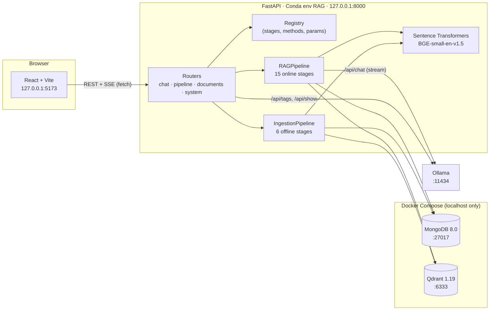
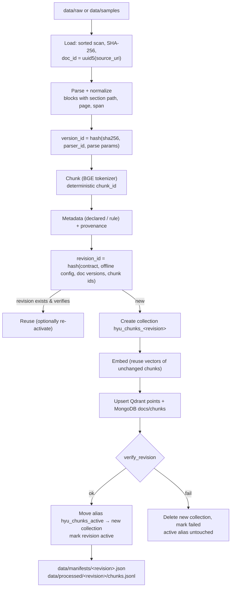
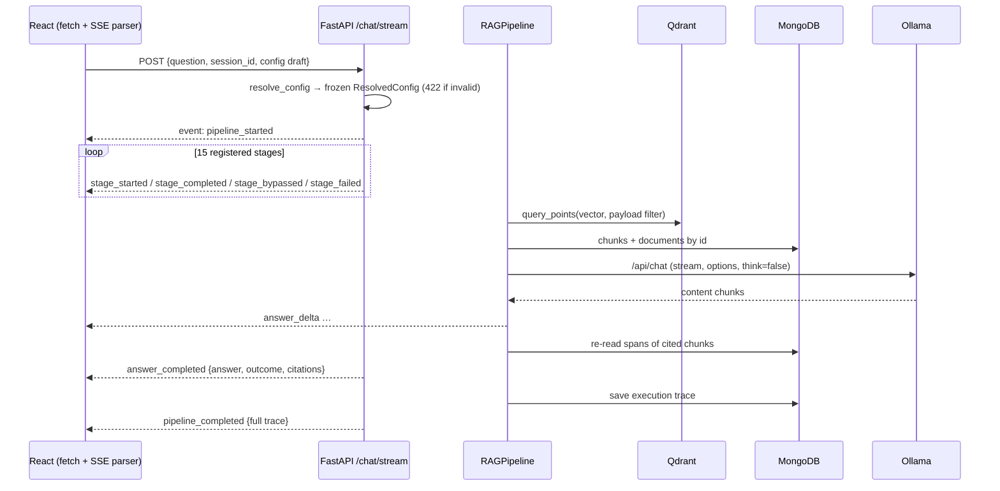
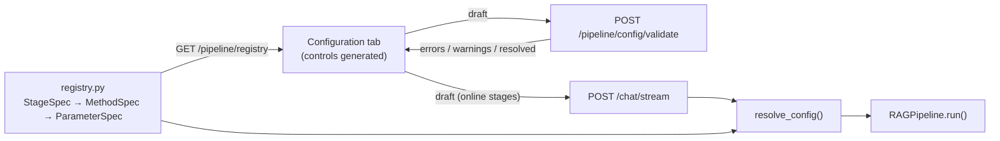

# Architecture

## Overview



Only FastAPI talks to MongoDB, Qdrant and Ollama. In development the Vite dev server proxies
`/api` to FastAPI, so the browser sees a single origin (CORS is still configured for
`127.0.0.1:5173` and `localhost:5173`).

## Responsibilities

| Component | Owns | Code |
|---|---|---|
| **MongoDB** | documents (one record per version, incl. normalized text), chunks (text, spans, metadata), index revisions, execution traces, presets, `extracted_facts` schema | `backend/app/repositories/mongodb.py` |
| **Qdrant** | one point per chunk: vector + compact payload (`doc_id`, `chunk_id`, `version_id`, campus, language, audience, document_type, topics, academic_year); versioned collections + the `*_active` alias | `backend/app/repositories/qdrant.py` |
| **Sentence Transformers** | document and query embeddings under an explicit contract | `backend/app/services/embeddings.py` |
| **Ollama** | answer generation only (never embeddings in the MVP) | `backend/app/services/ollama.py` |
| **Registry** | every stage/method/hyperparameter, defaults, validation, presets | `backend/app/rag/registry.py` |
| **Frontend** | rendering registry controls, streaming chat, trace inspection | `frontend/src/` |

## Offline ingestion



### Document versioning & provenance

- **Identity vs. version:** `doc_id = uuid5(source_uri)` never changes for a file path;
  `version_id` changes when the bytes or the parser contract change.
- **Immutable versions:** MongoDB stores documents with `_id = "<doc_id>:<version_id>"`, so a
  rebuild never overwrites the text that an older (still active) revision's spans point into.
- **Deterministic chunk IDs:** `uuid5(doc_id | version_id | chunker_id | config_hash | span | sha256(text))`.
- **Revisions:** an *index revision* is a hash of the embedding contract, offline configuration,
  document versions and chunk IDs. Two teammates ingesting the same files with the same settings
  obtain the same revision ID (verified: two fresh rebuilds both produced `c384769ff7b0`).
- **Spans:** `chunk.text == document.content[span.start:span.end]` is checked for every chunk
  during verification and again for every cited chunk at answer time.

### Safe publishing

The active index is the Qdrant alias `hyu_chunks_active` plus the MongoDB revision with
`status = "active"`. A rebuild writes a *new* collection while the old one keeps serving; only
after `verify_revision` passes are the alias (atomic delete+create in one request) and the
MongoDB status switched. `scripts/verify_index.py` checks that both agree.

## Online request



- The configuration snapshot is resolved and frozen **before** execution and stored with the
  trace (`config_hash`).
- The pipeline runs in an `asyncio` task that pushes events to a queue; the SSE generator drains
  it and sends a keep-alive comment every 10 s. If the client disconnects, the task is cancelled
  (closing the Ollama stream) and the trace is saved with status `cancelled`.
- Blocking work (PyMongo, Qdrant client, Sentence Transformers) runs via `asyncio.to_thread`;
  Ollama is called with an async `httpx` client.

## Pipeline registry



The UI never hardcodes an algorithm list. A planned method is visible but cannot be selected while
its stage is enabled, and the backend rejects it regardless (`ImplementationStatus.planned`).

## Real-time trace events

| Event | Payload |
|---|---|
| `pipeline_started` | question, config hash, active index revision |
| `stage_started` | `StageTrace` with status `running` |
| `stage_completed` / `stage_bypassed` / `stage_failed` | full `StageTrace`: method, implementation status, applied parameters, bounded input/output, measured `duration_ms`, error/bypass reason |
| `answer_delta` | generated text fragment |
| `answer_completed` | `AnswerResult` (final answer after the guard, outcome, citations, notes) |
| `pipeline_completed` / `pipeline_error` | full `ExecutionTrace` (also persisted in `execution_traces`) |

Schemas: `backend/app/models/pipeline.py` (`PipelineEvent`, `StageTrace`, `ExecutionTrace`) and
their TypeScript mirrors in `frontend/src/types/api.ts`. Payloads are bounded by
`app/services/tracing.py::bound` (strings ≤ 4000 chars, lists ≤ 50 items, explicit truncation
markers); embeddings are shown as model/dimension/norm/8-value preview, never in full.

## Frontend structure

```
src/
  App.tsx                    state wiring (config, chat, system), tab switching
  services/api.ts            REST client + fetch-based SSE parser
  hooks/                     usePipelineConfig (registry/draft/validation/presets), useChat (conversations,
                             streaming, per-request live traces), useSystem (health, Ollama), useMediaQuery
  lib/config.ts              pure draft-editing helpers (unit-tested)
  components/layout/         Header (service status), Workspace (resizable panels / mobile view)
  components/pipeline/       Configuration & Execution tabs, ParamControl, StageConfigCard, StageTraceCard, JsonView
  components/chat/           ChatPanel, MessageItem (markdown + citation links), Citations
  components/documents/      IndexDialog (active revision, documents, rebuild)
  components/ui/primitives   shadcn-style components on Radix (Tabs, Switch, Slider, Tooltip, Dialog)
```

Per-viewer preferences (panel sizes, theme, draft configuration, conversation list) are kept in
`localStorage`; execution traces are fetched from `GET /api/v1/traces/{request_id}` when an older
request is selected, so each request always shows its own trace.
