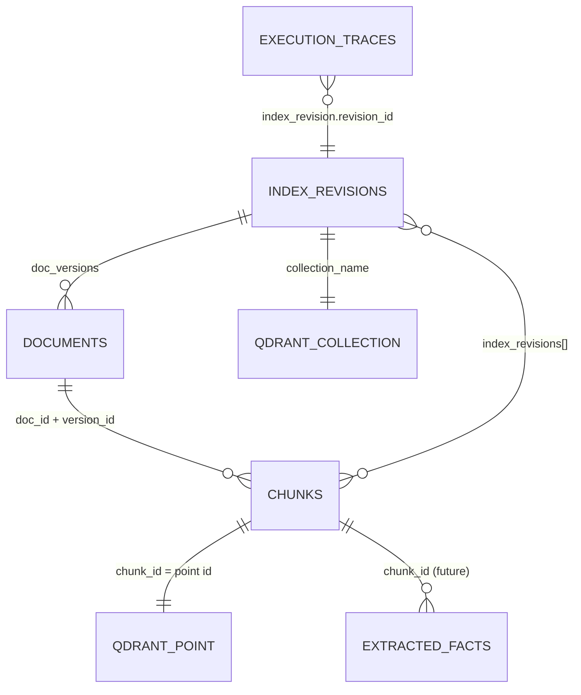

# Databases and Evaluation

## MongoDB (`MONGODB_DB`, default `hyu_compass`)

Schemas are the Pydantic models in `backend/app/models/documents.py` and `models/pipeline.py`.
Indexes are created by `MongoRepository.ensure_indexes()` at startup.

### `documents` — one record per **document version**

`_id = "<doc_id>:<version_id>"` (unique index on `doc_id, version_id`).

| Field | Meaning |
|---|---|
| `doc_id` | uuid5 of `source_uri` — stable logical identity |
| `source_uri` | `local://<path relative to data/>`, e.g. `local://samples/scholarships.html` |
| `file_path`, `media_type`, `size_bytes` | original file reference (the file itself is never modified) |
| `title`, `language`, `issuer`, `document_type`, `campus`, `audience`, `academic_year`, `publication_date`, `effective_from`, `effective_until`, `topics` | metadata; `null`/empty = **unknown** |
| `metadata_provenance` | per field: `declared` (stated by the source), `rule` (keyword rule), `parser`, `configured_default` |
| `source_sha256` | SHA-256 of the raw bytes |
| `parser_id` | e.g. `md-structure_aware-v1` |
| `version_id` | hash(source_sha256, parser_id, parsing params) |
| `content` | normalized text; every chunk span indexes into it |
| `parse_warnings`, `ingestion_status` (`parsed` / `indexed` / `failed`), `ingestion_errors`, `created_at`, `updated_at` | |

### `chunks`

`_id = chunk_id`. Fields: `chunk_id`, `doc_id`, `version_id`, `chunk_index`, `text`
(= `content[span]`), `context_header` (heading path used for embedding/BM25), `section_title`,
`section_path`, `page_number`, `page_end`, `source_span {start, end}`, `token_count` (BGE tokens),
`chunker_id`, `chunker_config_hash`, `topics`, `keywords`, `entities` (empty until entity
extraction exists), `metadata` (document fields copied for filtering/display), and
`index_revisions` (the revisions that contain this chunk).

### `extracted_facts`

Schema only (`ExtractedFact`: fact_id, doc_id, chunk_id, fact_type, subject, predicate, object,
conditions, exceptions, valid_from/until, evidence_span, extraction_method, review_status). **No
records are written** — the LLM extractor is planned, and we do not fabricate facts.

### `index_revisions`

`revision_id`, `collection_name`, `status` (`building` → `verified` → `active` → `superseded`, or
`failed`), `embedding` (the **embedding contract**: provider, model_id, model_revision, dimension,
normalize, distance, query_instruction, max_seq_length), `offline_config` (every offline stage's
resolved settings), `doc_versions` (doc_id → version_id), counts, vectors reused/computed,
`verification` report, timestamps.

### `execution_traces`

`_id = request_id`. `session_id`, `created_at`, `question`, `status`
(`completed` / `failed` / `cancelled`), `config` (frozen resolved snapshot + `config_hash`),
`index_revision` summary, `stages` (15 `StageTrace`s with bounded input/output), `result`,
`total_ms`, `error`. Payloads are bounded (strings ≤ 4000 chars, lists ≤ 50 items). Only the
question text and pipeline data are stored — no user identity or secrets.

### `presets`

User-saved configurations (`preset_id = "user_<slug>"`). Built-in presets live in the registry.

## Qdrant

- **Collections:** `hyu_chunks_<revision_id>` — one per index revision. Vector size from the
  model (384), distance from the contract (Cosine), HNSW `m`/`ef_construct` from the config.
- **Alias:** `hyu_chunks_active` → the published collection. Queries always use the alias.
- **Points:** `id = chunk_id` (UUID), vector, payload
  `{doc_id, chunk_id, version_id, campus, language, audience, document_type, topics, academic_year}`.
  Full text and rich metadata stay in MongoDB.
- **Payload indexes:** keyword indexes on every payload field (server mode; local mode ignores them).
- **Filtering** happens inside Qdrant (`query_filter`), so ineligible chunks never take Top-K slots.

## Relationships



## Index verification

`verify_revision()` (`backend/app/ingestion/pipeline.py`) runs before every publish, and
`python scripts/verify_index.py` runs it on demand:

1. collection exists; vector size and distance match the contract; query embedder contract matches
2. Qdrant point count = MongoDB chunk count = recorded chunk count; no duplicate IDs
3. no chunk without a vector, no point without a chunk (orphans)
4. every document version of the revision exists; no chunk references a version outside the revision
5. every chunk's span reproduces its text (`span_failures = 0`)
6. active alias target = MongoDB active revision (verify_index.py)
7. self-retrieval probe (warning only): 5 chunks embedded again should retrieve themselves first

Observed on the sample corpus: `points=24, mongo_chunks=24, span_failures=0, self_retrieval=5/5`.

### Reindexing behaviour

| Change | Effect |
|---|---|
| A source file's bytes | new `version_id` → its chunks get new IDs → new revision; other files' vectors are **reused** |
| Parser/chunker/metadata settings | new chunk IDs and/or payloads → new revision |
| Embedding model/revision/normalization/query instruction/distance | new contract → new revision, all vectors recomputed (never mixed) |
| `batch_size`, `device` | none (not part of the contract) |
| Same files + same settings (any machine) | same revision ID; existing verified revision is reused |
| Verification failure | new collection deleted, revision marked `failed`, active index unchanged |

Local databases do not synchronize between teammates. Commit `data/manifests/<revision>.json`
to compare: identical `revision_id` means identical documents, chunking and embedding contract.

---

## Evaluation

`scripts/evaluate.py` runs controlled ablations against the active index. Each experiment
changes **one** component relative to the dense baseline; index revision, embedding, evidence
settings and the question set stay fixed. Retrieval metrics and answer metrics are computed
separately.

| ID | Experiment | Status |
|---|---|---|
| A | Dense RAG baseline | runnable |
| B | Dense + BM25 (RRF k = 60) | runnable |
| C | Dense + metadata filtering (rule-based detection, exact filter) | runnable |
| D | Dense + reranking | **unavailable** — cross-encoder is planned |
| E | Full advanced pipeline | **unavailable** — needs reranking |

Each result file records: dataset path + SHA-256, index revision, embedding contract, the full
resolved configuration and its hash per experiment, per-query ranked documents, metrics, and
latency.

### Retrieval metrics (document level, cut-off k)

For a question with relevant set R and ranked document list L (de-duplicated from the candidates
after enrichment):

- **Precision@k** = |R ∩ L[:k]| / k — with one relevant document per question, the maximum is 1/k (0.2 at k = 5).
- **Recall@k** = |R ∩ L[:k]| / |R| — did the right document make it into the top k?
- **MRR** = mean of 1 / (rank of the first relevant document) — rewards putting it first.
- **nDCG@k** = DCG / ideal DCG with binary gains, DCG = Σ rel_i / log₂(i + 1) — position-discounted.

### Answer metrics (with `--with-generation`)

- **Answered / abstained** per question; on unanswerable questions abstention is the correct outcome.
- **Citation validity** = cited markers that resolve to stored chunks with verified spans / all cited markers. This measures *citation correctness*, **not grounding**.
- **Invalid markers** — citations to non-existent sources (removed by the guard).
- **Latency** — end-to-end wall-clock per question.
- **Grounding** (is each claim supported?) is *not* measured automatically; it needs claim
  verification or manual review of the stored answers (`queries[].qid` → trace).

### Measured results

Dataset: `data/eval/sample_questions.jsonl` (14 questions: 12 answerable with document labels,
2 unanswerable; SHA-256 `4201ff43…`). Index: revision `c384769ff7b0` (5 synthetic sample documents,
24 chunks, `BAAI/bge-small-en-v1.5@5c38ec7c`, structure-aware chunking 256/32). Qdrant local mode
(exact search). Run on 2026-10-28.

> **Measurement environment caveat:** Docker was not available on the development machine, so
> these runs used Qdrant local mode and an in-memory MongoDB substitute (mongomock). Neither
> affects ranking or generation, but latency numbers are **not** representative of the Docker
> setup, and generation latency depends on the local machine.

**Retrieval ablation** (`data/eval/results/c384769ff7b0_retrieval_ablation.json`, k = 5):

| Experiment | P@5 | R@5 | MRR | nDCG@5 | median latency (retrieval only) |
|---|---|---|---|---|---|
| A Dense | 0.200 | 1.000 | 0.944 | 0.958 | 15 ms |
| B Dense + BM25 (RRF) | 0.200 | 1.000 | 0.958 | 0.969 | 15 ms |
| C Dense + metadata | 0.200 | 1.000 | 0.944 | 0.958 | 15 ms |
| D, E | unavailable | | | | |

**Answer evaluation** (`data/eval/results/c384769ff7b0_answers_qwen3-4b.json`, model `qwen3:4b`,
temperature 0, seed 42, `num_predict` 1024):

| Experiment | Answerable answered | Unanswerable abstained | Citation validity | Invalid markers | Failed runs | median latency |
|---|---|---|---|---|---|---|
| A Dense | 12/12 | 2/2 | 1.00 | 0 | 0 | 17.9 s |
| B Dense + BM25 | 11/12 | 2/2 | 1.00 | 0 | 1 | 20.0 s |
| C Dense + metadata | 12/12 | 2/2 | 1.00 | 0 | 0 | 21.6 s |

How to read this honestly:

- The corpus has **5 short documents**, so retrieval is nearly saturated (R@5 = 1.0 everywhere).
  The difference in MRR (0.944 vs 0.958) comes from **one** question: q10 "I lost my student ID
  card. What should I do?" — dense retrieval ranks the relevant student-services file 3rd (behind
  orientation and registration chunks that mention "student ID"); BM25 fusion lifts it to 2nd.
  These numbers verify that the evaluation machinery works; they do **not** show that
  one method is better in general. A real comparison needs the team's real corpus and more
  labelled questions.
- **Finding 1 (metadata filtering bug, fixed):** before the fix, C scored R@5 = 0.917 and MRR 0.861
  (`…_before_audience_fix.json`). Cause: “first-year student” was detected as `audience=freshman`,
  and the exact filter excluded the course-registration handbook whose declared audience is
  `undergraduate`. A freshman *is* an undergraduate, so the filter now accepts broader audiences
  (`AUDIENCE_PARENTS` in `app/ingestion/metadata.py`). This is the kind of eligibility error the
  ablation exists to catch.
- **Finding 2 (output budget):** the one failed B run (q08) is `qwen3:4b` spending the whole
  `num_predict = 1024` budget on hidden reasoning. The stage failed with an explicit message rather
  than showing reasoning as an answer. For thinking models, use `num_predict ≥ 2048`.
- **Finding 3 (model choice):** in manual runs, `llama2:latest` wrongly answered
  `INSUFFICIENT_CONTEXT` for q07 although the evidence contained the answer; `qwen3:4b` answered
  it with a valid citation. Model choice matters at least as much as retrieval settings here.
- Citation validity 1.00 means every citation pointed at real evidence with a verified span. It
  does not mean every claim was correct.

### Running experiments

```bash
conda activate RAG
python scripts/evaluate.py --questions data/eval/sample_questions.jsonl                     # retrieval only, seconds
python scripts/evaluate.py --questions data/eval/sample_questions.jsonl --with-generation --model qwen3:4b   # minutes
```

To build your own set: one JSON object per line with `qid`, `question`, `relevant` (list of
`source_uri`s; empty for unanswerable) and `answerable`. Label before looking at results, keep a
held-out split if you tune thresholds (e.g. `min_dense_score`), and change one setting per run.
